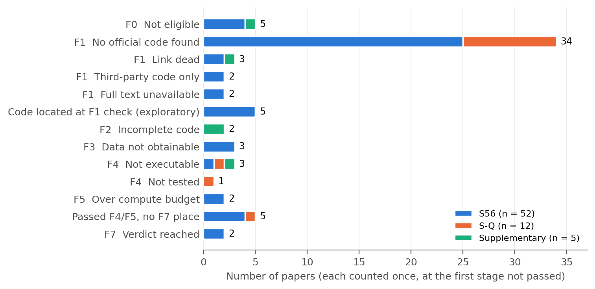
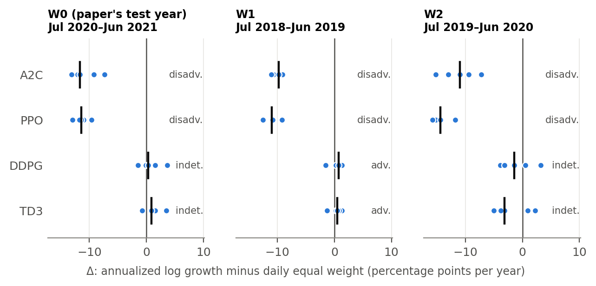

# [check: title]

## Abstract

This thesis examines whether reinforcement-learning (RL) portfolio methods that appear to outperform simple allocation still do so under careful evaluation. It first reports the author's development of an RL allocation system. A hierarchical policy over 44 cryptocurrency pairs earned a test Sharpe ratio of 2.60 against 0.26 for equal weight, but thirteen of sixteen training seeds had a negative Sharpe ratio in validation, most of its test result was reproduced by equal weight held along its exposure path, and about two thirds of its test log growth came from the evaluation's initial holding, an effect that overlaps with that exposure path; a pre-registered study showed that this start-state effect grows with a policy's inertia and follows the market's first days, adding variance rather than a consistent bias. In a held-out period evaluated once under criteria fixed in advance, its advantage over the same exposure was not maintained. The main study then asks the same question of published methods. We followed 69 papers through fixed stages from eligibility to a reproduction verdict; ran, under criteria fixed in advance, the official code of four pre-selected methods and of two papers that reached the last stage; checked whether three official environments charge their configured costs; and re-evaluated the one eligible method (FinRL) against equal weight (1/N) under a common protocol. In the main sample, 31 of 52 papers exited at the code-availability stage. None of the six papers judged was fully reproduced with the code as of publication: three were partially reproduced and three were not. Two of three environments did not charge the configured cost, and in four of thirteen implementations checked the training signal did not respond to it. No FinRL agent retained an advantage over equal weight: two lost it and two were indeterminate, and exploratory diagnostics showed fixed-weight and effectively untrained policies whose summary metrics did not reveal this. Where the source of an apparent advantage could be traced, in the author's system, the FinRL agents and one exploratory reproduction, it lay mainly in fixed allocations, exposure and the evaluation's initial holding rather than in period-by-period decisions. These results do not show that reported numbers are wrong or that RL cannot outperform equal weight; the system is one development line and the published methods a selected group.

# Chapter 1. Introduction

This thesis examines whether reinforcement-learning portfolio methods that appear to outperform simple allocation still do so under careful evaluation. Its main contribution is a pre-registered reproduction and re-evaluation of published RL portfolio methods from their official code (Chapters 6–7). Chapters 3–5 describe the author's own development of an RL allocation system: its apparent advantage did not survive the author's own checks, and this outcome motivated the reproduction study.

## 1.1 Motivation

Deep reinforcement learning (RL) has become a common approach to portfolio allocation. A typical paper trains a policy that maps recent market data to portfolio weights, evaluates it on a held-out period, and reports that it outperforms a market index and a set of baselines (e.g., Jiang et al., 2017; Liu et al., 2021; Sun et al., 2023; Kim et al., 2025; Chen et al., 2026). Such reports can be difficult to assess from the papers alone. Results may be given for a single test period; the number of training runs and how a reported run was chosen from them may not be stated; transaction costs are described in the text, but whether the code charges them is not usually shown; the initial holding of the evaluation is rarely varied; and the comparison set may omit the equal-weight (1/N) portfolio, which is known to be hard to beat out of sample (DeMiguel et al., 2009).

The author met these difficulties first as a developer rather than as a reader. An RL allocation system built for this thesis on cryptocurrency, after a series of design changes, earned a Sharpe ratio of 2.60 in its test period against 0.26 for equal weight. Later checks showed that the chosen seed was the second-best of sixteen, thirteen of which had a negative Sharpe ratio in validation; that most of the test result was reproduced by equal weight held along the policy's exposure path; and that about two thirds of its test log growth came from the evaluation's initial holding, an effect that overlaps with that exposure path. In a period not used for any decision, evaluated once under criteria fixed beforehand, its advantage over the same exposure did not hold. These problems need not be specific to the system, which raised the question of how the results of published methods would fare under the same scrutiny.

Two lines of prior work bear on this question. Studies of reproducibility in machine learning have shown that RL results are sensitive to random seeds, implementation details and evaluation choices (Henderson et al., 2018), that papers document only a fraction of the information needed to reproduce them (Gundersen and Kjensmo, 2018), and that independent reimplementation succeeded for 63.5% of 255 papers in one large attempt (Raff, 2019). In finance, large-scale replications of published return anomalies have reached different conclusions about how many survive (Hou et al., 2020; Jensen et al., 2023).

Closer to our setting, a survey of RL trading systems found source code for only one of 29 papers (Felizardo et al., 2022), and a preprint auditing 685 stock-prediction studies, including deep RL, reported code for 7.6% of them (Srikantha et al., 2026). Published code has been re-run for deep-learning price prediction from limit order books, with performance below the reported values (Prata et al., 2024), and the authors of a financial RL framework have reproduced papers of their own group within it (Liu et al., 2022). Benchmarking studies have re-run open-source deep RL agents under common conditions (Velay et al., 2023), and Kruthof and Müller (2025) ask whether deep RL can beat 1/N. We are not aware of independent re-runs of the official code of RL portfolio papers, with criteria fixed in advance, that ask whether the code yields the reported values and whether any advantage remains once transaction costs are charged and 1/N is included as a baseline. This is the gap the reproduction study addresses.

## 1.2 Research questions

The author's own work (Chapters 3–5) asks one preliminary question.

- **Q0 (own system).** Does an RL allocation system built from a pretrained time-series encoder and PPO agents in a hierarchical design, and judged favorably by a standard backtest, retain an advantage over simple allocation under further checks and in a period not used for its development?

The reproduction study (Chapters 6–7) addresses three questions for papers that propose an RL method for multi-asset portfolio allocation.

- **RQ1 (availability).** For how many papers can a reproduction from the authors' code be attempted at all, and at which stage do the others drop out?
- **RQ2 (reproduction).** When the authors' code is run under its own procedure, does it yield the reported values and support the paper's comparative claim?
- **RQ3 (robustness).** For pre-selected methods whose results are reproduced at least in part, does the advantage remain under a common protocol with correctly charged transaction costs, a cash start, several test windows, several seeds and an equal-weight baseline?

## 1.3 Approach

For Q0, the author built allocation policies on Korean and U.S. equities (Chapter 3) and on 44 cryptocurrency pairs (Chapter 4), the latter a hierarchical design ported from EarnHFT (Qin et al., 2024), and then checked the final cryptocurrency policy against sixteen training seeds, exposure-matched benchmarks, alternative initial holdings and a period held out from all development (Chapter 5). The development work preceded the adoption of pre-registration and is reported as exploratory. Several of the later checks were pre-registered, among them a study of how the evaluation's initial holding affects measured performance, a retraining at longer decision intervals, two diagnostic tools and the test in the held-out period.

For RQ1, we followed 69 papers from three samples through a fixed sequence of stages (the reproduction funnel): eligibility, availability of official code, completeness of the code, availability of reported values to compare against, availability of the data, execution, compute budget and, finally, a reproduction verdict. Each paper is counted once, at the first stage it does not pass. Exits at the execution and compute stages are outcomes under our environment and time limits and are not counted as reproduction failures. By design, at most two papers in a fixed order could receive a verdict. Because most papers exited at the code-availability stage, every such judgment was re-checked by a human rater, except for two papers whose full text could not be obtained.

For RQ2, we ran the official code of four methods selected in advance for in-depth study (DeepAries, AlphaMix+, the FinRL portfolio agents and MARS) and of the two papers that reached the last stage of the funnel (the ensemble strategy of Yang et al., 2020, and the Relation-Aware Transformer of Xu et al., 2020). For each, the reported value, the aggregation over runs and two criteria — whether our aggregate lies within a tolerance band around the reported value (R1) and whether the paper's comparative claim holds in our runs (R2) — were fixed before any performance output was produced or opened. Code was modified only within a pre-specified set of permitted changes (for example, compatibility shims, date and split arguments, and logging), and every change is reported. Four further papers were run outside the fixed order and are reported as exploratory.

For RQ3, we first checked whether the official environments of three of the four pre-selected methods (all but MARS) charge the transaction cost they are configured with, by driving the runnable environments with injected actions (one environment was assessed by reading the code only). Among the pre-selected methods, those reproduced at least in part — in practice, the four FinRL agents — were then retrained and evaluated under a unified protocol with a reference cost model and compared with a daily-rebalanced equal-weight portfolio of the same assets, using pre-specified classification rules, with block-bootstrap effect sizes specified afterwards. Diagnostics of what the trained policies do were added afterwards and are labelled exploratory.

## 1.4 Summary of findings

**Own system (Q0).** On equities, the directional accuracy of every forecasting backbone was within about one percentage point of the share of up-moves, and an RL allocation that beat equal weight on Korean stocks did so, in the runs checked, through a static tilt that a fixed portfolio reproduced. On cryptocurrency, the final hierarchical policy earned +8.73% with a Sharpe ratio of 2.60 in its test period, against −0.81% and 0.26 for equal weight. Of sixteen training seeds of the same configuration, thirteen had a negative Sharpe ratio in validation; no computed confidence interval of a Sharpe ratio excluded zero; and equal weight held along the policy's exposure path reached a test Sharpe ratio of 2.00. Starting the evaluation from the policy's own holdings instead of a fully invested equal-weight portfolio lowered the test return to +2.86%. A pre-registered study found that this start-state effect grows with the policy's inertia and follows the market's movement in the first days of the evaluation, adding variance rather than a consistent bias. In the held-out period, the policy returned −0.32% against +2.47% and +2.03% for BTC and equal weight held along the same exposure path, and under the pre-registered rule its advantage was not maintained.

**Availability.** Of the 52 papers in our main sample, 31 exited at the code-availability stage, 25 of them because no official code could be found (authors were not contacted). Two papers reached a reproduction verdict through the funnel; five further papers passed the execution stage but did not receive a verdict because the two places had been filled. Across the three samples, the human check of the 44 papers that had not passed the code-availability stage located official code for four, and an exploratory search of author accounts for a fifth, in each case only through an author's personal GitHub account. Because a search of author accounts found only two of five repositories already known to us, "no official code found" is an upper bound on the number of papers without code.

**Reproduction.** None of the six papers was fully reproduced with the code as of publication and the definitions fixed in advance. Three were partially reproduced (FinRL, the ensemble strategy and the Relation-Aware Transformer) and three were not reproduced (DeepAries, AlphaMix+ and MARS). Within FinRL, two of four algorithms (PPO and TD3) were reproduced individually. For two papers, the verdict changes with a choice the paper leaves unspecified (the reported training epoch and the definition of the market average for AlphaMix+) or with the code version and evaluation window (a later revision of the MARS repository by its authors met both criteria under one of two plausible evaluation windows; this is reported alongside, not as the MARS verdict).

**Costs.** Of three official environments checked, two did not charge the transaction cost they were configured with, and the third charged it with a formula different from the one stated in the paper, with a negligible effect at the paper's fee. In a pre-registered check of thirteen implementations from eight code lineages, the training signal did not respond to the configured cost in four; in one of these the cost was charged in evaluation but not in training, so a mismatch between training and evaluation did not recur across lineages under the pre-specified rule.

**Robustness.** Under the unified protocol, none of the four FinRL algorithms retained an advantage over equal weight. Two lost it — exploratory diagnostics attribute most of the loss to turnover generated by stochastic prediction, and for A2C the classification depends on the prediction setting; the other two were indeterminate, with differences in annualized log growth inside an equivalence margin of ±2.36 percentage points per year (fixed before the effect-size analysis, which was specified after the classifications were known) and Sharpe-ratio differences undetermined. Exploratory diagnostics showed that these two had become fixed-weight portfolios and that PPO behaved like its untrained initialization; the reproduced advantage over the index in the paper's test year is consistent with an allocation close to equal weight having outperformed the index in that year. In an exploratory reproduction of a further paper, whose released code uses five stocks rather than the 30 described and omits the proposed distillation component, the stored runs behind the reported curve were positions bought on the first day and held unchanged; retraining met the value criterion, but no seed exceeded an equal-weight portfolio of the same five stocks. In an exploratory comparison of three further judged methods with equal weight, DeepAries was mixed, MARS as published mostly did not exceed it, and the ensemble strategy exceeded it in all runs, with the difference concentrated in a period when its turbulence rule moved it to cash.

**Taken together.** Where the source of an apparent advantage over simple allocation could be traced (the author's system, the FinRL agents and one exploratory paper), it lay mainly in fixed or near-fixed allocations, in exposure and in the evaluation's initial holding rather than in period-by-period decisions, and where an advantage was lost once costs were charged, turnover explained most of the loss (exploratory); for the ensemble strategy the source of its gap to the reported value was not identified, and its advantage over equal weight was concentrated in a period when its turbulence rule moved it to cash (exploratory); for the Relation-Aware Transformer the source was not identified. The two parts differ in kind: the first is one developer's system, the second a selected group of published methods, and neither supports a claim about RL portfolio methods in general.

## 1.5 Contributions

Contributions are listed in chapter order; items 3–6 form the main contribution.

1. A documented development case of an RL allocation system that looked strong under a standard backtest, with the checks that accounted for its result, including a pre-registered test in a held-out period that it failed.
2. A pre-registered test of how the evaluation's initial holding affects the measured performance of policies with inertia. Sensitivity of backtests to their start date (Anderson et al., 2012) and to their rebalancing dates (Hoffstein et al., 2019) is known; to our knowledge no RL portfolio study has varied the evaluation's initial holding, and in a single-coder reading of 56 RL portfolio papers none used a warm-up before evaluation or reported sensitivity to the initial holding. The same test applied to the published EIIE and EI3 implementations of FinRL's portfolio-optimization environment found no learned inertia and no material effect.
3. A reproduction funnel over 69 RL portfolio papers with fixed stages and a human-checked code-availability stage, which separates papers that could not be attempted from those that were attempted and failed.
4. Pre-registered reproduction verdicts for six papers from the authors' own code, with tolerance bands and comparative criteria fixed before results were seen, and with verdicts that depend on unspecified choices reported under each reading.
5. A check of whether official portfolio environments charge their configured transaction costs, by injected actions where the environment could be run, and a pre-registered check of whether the training signals of official code bases (thirteen implementations assessed, sixteen examined) respond to the configured cost.
6. A re-evaluation of the FinRL portfolio agents under a common protocol with effect sizes against 1/N, together with exploratory descriptions of how policies obtained from the released code degenerate (fixed weights, behaviour indistinguishable from initialization, first-day buy-and-hold).

Our literature search was not exhaustive, and we do not claim priority for these items or their combination.

## 1.6 Scope

The author's own work was carried out before pre-registration was adopted, and except for the tests identified as pre-registered it is exploratory; several design choices were made after seeing test-period results, and they are identified where they occur. The live trading account described in Chapter 5 is an operational record, not evidence about performance. The verdicts of the reproduction study concern the released code run under the stated definitions; they do not show that any paper's reported numbers are wrong, since our runs differ from the authors' in hardware, library versions and nondeterminism, and several papers do not specify the procedure behind the reported value. The papers studied in depth are a selected group, several of which share a code lineage, so we do not report a single reproduction rate and do not generalize beyond the samples. The check of the code-availability stage was carried out by a single rater who was not blind to the original judgments. The equivalences with 1/N hold for the configuration tested. Papers run outside the fixed order and all policy diagnostics are exploratory and describe particular code under particular settings.

## 1.7 Outline

Chapter 2 reviews related work on reproducibility in machine learning and finance and on RL for portfolio allocation. Chapters 3–5 describe the author's own work in the order it was done: forecasting and RL allocation on equities (Chapter 3), the hierarchical RL system for cryptocurrency (Chapter 4), and the checks of its result (Chapter 5). Chapter 6 describes the design of the reproduction study and reports the funnel and the reproduction verdicts. Chapter 7 reports the cost check, the unified-protocol re-evaluation and the exploratory diagnostics. Chapter 8 discusses the results of both parts and their limitations, and Chapter 9 concludes. Appendix A describes a team entry to an ETF investment competition in which the author's forecasting model and allocation pipeline were used.

# Chapter 2. Related work

## 2.1 Reproducibility in machine learning and reinforcement learning

Concerns about reproducibility in machine learning have been documented at several levels. Gundersen and Kjensmo (2018) examined 400 papers from IJCAI and AAAI and analysed 325 empirical ones, finding that only 20–30% of the variables needed to reproduce the methods, data and experiments were documented. Collberg and Proebsting (2016) attempted to build the code of 402 computer-systems papers backed by code and succeeded within 30 minutes for about a third; they did not check whether the results were reproduced [check: figures confirmed in the technical-report version only]. Raff (2019) reimplemented 255 machine-learning papers without using the authors' code and succeeded for 162 (63.5%); whether code was released was not a significant predictor of success.

For deep RL specifically, Henderson et al. (2018) showed that reported performance depends on hyperparameters, network architecture, reward scale, random seeds, environment details and the codebase; in one example, two groups of five runs of the same algorithm, differing only in random seed, produced learning curves that differed significantly. A single run, or a run chosen from several without a stated rule, may therefore not represent an algorithm's behaviour — a point that applies directly to RL methods evaluated on a single financial test period.

## 2.2 Replication in empirical finance

Empirical finance has its own replication literature, focused on return anomalies rather than learning algorithms. Hou et al. (2020) re-examined 452 published anomalies and found that, with the influence of microcaps mitigated through NYSE breakpoints and value-weighted returns, 65% had |t| < 1.96. Jensen et al. (2023), using a different design across 153 factors in 93 countries, concluded that most factors do replicate (82.4% on CAPM alphas). The contrast between these conclusions illustrates that a replication verdict depends on the criteria applied, which is why we fix ours in advance and report verdicts under alternative readings where a paper leaves a choice open.

## 2.3 Reinforcement learning for portfolio allocation

RL methods for multi-asset portfolio allocation map market observations to portfolio weights or trades and are typically trained to maximize a return-based reward. Early influential work includes the EIIE framework of Jiang et al. (2017), which outputs portfolio weights directly through a softmax, and the stock-trading agents of Liu et al. (2018), which trade share quantities. Several lines followed.

- **The FinRL lineage.** The FinRL library (Liu et al., 2020) and the FinRL framework paper (Liu et al., 2021) provide environments and agents built on Stable-Baselines3 (Raffin et al., 2021), including a portfolio-allocation environment whose agents (A2C, PPO, DDPG and TD3; Mnih et al., 2016; Schulman et al., 2017; Lillicrap et al., 2016; Fujimoto et al., 2018) we study in depth. FinRL-Meta (Liu et al., 2022) adds market environments and benchmarks. Several methods share code with these environments, among them the ensemble strategy of Yang et al. (2020), Margin Trader (Gu et al., 2023) and Markowitz Meets Bellman (Hu and Gu, 2024); the AlphaMix+ environment of PRUDEX-Compass (Sun et al., 2023) also derives from the FinRL portfolio environment.
- **Architectures for cross-asset structure.** The Relation-Aware Transformer (Xu et al., 2020), WaveCorr (Marzban et al., 2021) and EarnMore (Zhang et al., 2024) propose network designs that model relations among assets or allow the asset pool to change.
- **Cost-aware and adaptive methods.** The Portfolio Policy Network (Zhang et al., 2020) incorporates transaction costs into the learning objective; DeepAries (Kim et al., 2025) learns when to rebalance as well as the weights; MARS (Chen et al., 2026) uses an ensemble of agents whose risk profiles are enforced by a safety critic, coordinated by a meta-adaptive controller.
- **Hybrid methods.** Pretorius and van Zyl (2022) combine deep RL with convex mean–variance optimization, and HARLF (Coriat and Benhamou, 2025) combines hierarchical RL with language-model sentiment.

Many of these papers evaluate on a single test period, compare with a market index and with other learned or classical strategies, and configure transaction costs as a fixed proportional rate [check: replace "many" with counts from the funnel coding if available]. These papers are the objects of our study; their verdicts are reported in Chapter 6.

## 2.4 Hierarchical RL, structured actions and time-series encoders

The author's own system (Chapter 4) ports a hierarchical method from high-frequency trading. EarnHFT (Qin et al., 2024) trades a single cryptocurrency with discrete positions at second-level frequency in three stages: a dynamic-programming teacher supplies optimal action values under different risk preferences and is used to train a large pool of agents; a validation stage keeps a small, diverse subset for each market regime; and a router selects among them. Its authors report that single PPO and DQN agents underperform the hierarchy on four cryptocurrency datasets. Hierarchical RL has also been applied to multi-asset portfolios with other splits of the problem: between allocation and order execution (HRPM; Wang et al., 2021a) and between stock selection and weighting (Zha et al., 2022). More generally, a fixed set of sub-policies with a policy that switches among them is an instance of the options framework (Sutton et al., 1999). [check: DeepTrader (Wang et al., 2021b) and MoEDRLPM (Wei et al., 2025) only after reading the full texts.]

Two recent portfolio methods inspired the action design used in Chapter 4: FreQuant (Jeon et al., 2024), which restricts the portfolio to a subset of assets chosen by a learned score [check: verify the top-$K$ mechanism against the full text], and DeepClair (Choi et al., 2024), which takes long positions in the highest-scored and short positions in the lowest-scored assets and uses a separate market module to set the ratio between them. Damping weight changes, used at execution time in Chapter 4, relates to smoothness regularization of RL controllers in robotics (CAPS; Mysore et al., 2021), where the smoothing enters training rather than execution.

The state of the author's policies is produced by time-series encoders. Recent forecasting backbones include patch-based and inverted Transformers (PatchTST, Nie et al., 2023; iTransformer, Liu et al., 2024), an MLP-based stock model (StockMixer, Fan and Shen, 2024), a graph network that learns relations among variables (MTGNN, Wu et al., 2020), state-space models (Mamba, Gu and Dao, 2023), and Chronos (Ansari et al., 2024), a language-model architecture pretrained on many time series and usable without further training; reversible instance normalization (Kim et al., 2022) addresses distribution shift, changes in the mean and variance of a series over time. Chapter 3 compares several of these on Korean stocks and uses a combination of Chronos and MTGNN as the encoder for RL.

## 2.5 Evaluation, code availability and re-runs in financial machine learning

Several studies have assessed how financial machine learning is evaluated and reported. Felizardo et al. (2022) surveyed 29 papers on RL for trading and found source code for only one. Srikantha et al. (2026), in a preprint that has not yet been peer-reviewed, audited 685 stock-prediction studies, 176 of them using deep RL, and found released code for 52 (7.6%). Neither study re-ran code. PRUDEX-Compass (Sun et al., 2023) proposes a multi-axis evaluation of RL methods in financial markets, and FinRL-Meta (Liu et al., 2022) reproduces popular papers, mostly by the same group, as tutorials within the framework.

Re-runs of published code exist outside RL. Prata et al. (2024) re-ran 15 deep-learning models for stock-price trend prediction from limit-order-book data under common conditions and found that all of them performed substantially worse on new data [check: whether they also fell below the reported values on the original benchmark]. Within RL for portfolio management, Velay et al. (2023) evaluated classical deep RL algorithms under a common training and evaluation procedure and found that most were not robust, generalizing poorly and degrading quickly in back-tests; they did not compare against the reported numbers of specific papers. Li (2024) reproduced a single method (EIIE). We did not find an independent study that re-runs the official code of a sample of RL portfolio papers against their reported values under criteria fixed in advance, and our search was not exhaustive.

## 2.6 The equal-weight benchmark and degenerate learned allocations

DeMiguel et al. (2009) showed that none of fourteen optimized allocation models was consistently better than the 1/N portfolio out of sample across seven datasets, and attributed this to estimation error offsetting the gains from optimization. The 1/N portfolio has since become a standard reference for allocation methods; among the six papers that received a reproduction verdict in our study, four (DeepAries, FinRL, the ensemble strategy and MARS) do not include it among their comparators, whereas AlphaMix+ compares with a market average that invests equal amounts in all assets and the Relation-Aware Transformer with a uniform constant-rebalanced portfolio.

Comparisons of deep RL with 1/N have reached unfavourable conclusions. Kruthof and Müller (2025) ask whether deep RL can beat 1/N [check: state their finding, and add Aarnio (2025) and Lavko et al. (2023), only after reading the full texts].

There are also reports that learned allocations degenerate. André and Coqueret (2020) found, across a wide range of parameter choices, that RL-based factor portfolios trained with Dirichlet policies were very close to the equally weighted allocation. Li (2024), reproducing EIIE with a modified version of its public code base, found that in stock-market back-tests the learned portfolio stayed nearly uniform throughout, so that the method behaved like a uniform constant-rebalanced portfolio. Mohammadshafie et al. (2024) compared A2C, PPO, SAC, DDPG and TD3 trading agents and reported that PPO and SAC traded frequently in a few stocks, whereas DDPG and TD3 spread purchases more evenly and, like A2C, held positions longer; their experiments used the FinRL environment. Users of the FinRL portfolio environment have also reported publicly that its performance changed little when the inputs were altered.¹ In continuous control more generally, Seyde et al. (2021) documented that trained agents often prefer actions at the boundaries of the action space and that Bernoulli (bang-bang) policies perform competitively on standard benchmarks.

Fixed-weight and near-equal-weight policies, such as those we observe (Chapters 3 and 7), are therefore not new as phenomena. What we add is that they are observed in the official code of two published methods (FinRL; and, in an exploratory analysis, Markowitz Meets Bellman, including the stored runs behind its reported result), that the range of weights is bounded by the parameterization in the code (in the FinRL portfolio environment, a softmax over actions in [0, 1], which confines each of 28 weights to [1.34%, 9.15%]), and that these observations are linked to the reproduction and re-evaluation verdicts of the same methods.

¹ FinRL repository, issue #340 (2021): replacing the covariance input of the portfolio environment with historical returns, and even supplying the next day's return, had little or no effect on an A2C agent's performance; issue #968 (2023): adding or removing technical indicators made little or no difference for PPO and A2C agents. These are user reports, not peer-reviewed results. https://github.com/AI4Finance-Foundation/FinRL/issues/340, https://github.com/AI4Finance-Foundation/FinRL/issues/968.

## 2.7 Backtest overfitting, selection and the start of an evaluation

A backtest that is the best of several trials overstates what can be expected. The Deflated Sharpe Ratio (Bailey and López de Prado, 2014) corrects an observed Sharpe ratio for the number of trials from which it was selected and for non-normal returns, and the probability of backtest overfitting (Bailey et al., 2017) estimates, by combinatorially symmetric cross-validation, how often the configuration chosen in sample underperforms the median of the configurations out of sample. For deep RL in cryptocurrency trading, Gort et al. (2022) formulate the detection of backtest overfitting as a hypothesis test, estimating the probability of overfitting and rejecting agents that are likely overfitted. Chapter 5 applies the Deflated Sharpe Ratio to the author's seeds and a permutation test to the gap between validation and test performance.

The measured performance of a strategy also depends on when its evaluation starts and on the portfolio it starts from. Anderson et al. (2012) found that, even over periods lasting decades, the start and end dates of a backtest can have a material effect on the results of static allocation strategies, and Hoffstein et al. (2019) illustrate that shifting only the dates on which an otherwise identical strategy rebalances changes its performance. For policies whose next weights depend on their current holdings, the initial holding of the evaluation is part of the state, so a fixed choice such as cash or equal weight can affect the result for as long as the policy takes to move away from it. Chapter 5 reports a pre-registered test of this effect and a reading of 56 RL portfolio papers for how they set the initial holding.

## 2.8 Transaction costs and market regimes in RL environments

Transaction costs bear directly on whether an allocation strategy is profitable: DeMiguel et al. (2009) report turnover alongside Sharpe ratio and certainty-equivalent return, RL portfolio environments commonly charge a proportional cost on the change in weights or traded value, and some methods model costs in the objective (Zhang et al., 2020). Abbade and Costa (2026) note that most open-source backtesting environments assume negligible or fixed transaction costs, and add nonlinear market-impact models to RL trading environments. Whether an environment's code actually charges the configured cost has, to our knowledge, not been checked systematically; Chapter 7 reports such a check for three of the four methods studied in depth.

Some methods also react to market regimes. The ensemble strategy of Yang et al. (2020) moves to cash when a turbulence index exceeds a threshold; the index follows Kritzman and Li (2010), who define financial turbulence as the Mahalanobis distance of returns from their historical mean. The released code computes the index from price levels; we kept the code's definition (Chapter 7).

## 2.9 Position of this study

The author's own work (Chapters 3–5) is a development case: it applies existing encoders, a ported hierarchy and existing action designs, and contributes no new method. What it adds to the work above is a record of how such a system's apparent advantage was accounted for, and a pre-registered test of the effect of the evaluation's initial holding.

Relative to the work above, the reproduction study (i) follows a sample of RL portfolio papers through fixed stages from eligibility to a reproduction verdict, (ii) runs the authors' official code against the reported values with criteria fixed in advance, (iii) checks whether the official environments charge the costs they are configured with, and (iv) re-evaluates reproduced methods against 1/N under a common protocol. Each element has precedents — documentation and code-availability audits, re-runs of prediction models, benchmarks of generic RL agents against common baselines, and reports of degenerate learned allocations. The combination, applied to the official code of published RL portfolio methods, is what distinguishes the present study.

# Chapter 3. Forecasting and RL allocation on equities

---

**Summary.** The project began with a different question: can deep time-series models forecast Korean stock returns well enough to drive a portfolio? Across eight forecasting backbones, directional accuracy on the held-out test sequences lay between 0.496 and 0.515, around the share of up-moves (0.505). The forecasting signal was weak at best. An encoder built from these backbones then served as the state of a PPO agent allocating among five clusters of stocks. The first result, +0.28% against +34.33% for equal weight over two test years, was unreliable: the same code with a different encoder gave +137.22%, and inspection of the pipeline revealed four defects, including overlaps between the periods used to build the clusters and the encoder and the test period. After these and the cost accounting were corrected, the agent beat equal weight in nine of ten runs, but a static portfolio holding its average training-period weights performed almost identically: it had learned a fixed tilt, not a timing rule. A hierarchical variant chosen on validation failed in the test period. On U.S. large-capitalization stocks, single runs found a raw-price PPO agent tied with equal weight, an embedding-based agent behind it, and a hierarchical variant close to it. None of these equity experiments found an RL allocation that beat equal weight through decisions made period by period.

---

## 3.1 Data

The Korean universe consists of stocks listed on the KOSPI market at the time of data collection. Of 837 stocks, those with fewer than 500 trading days or more than 10% missing volume over 2020–2026 were removed, leaving 781. Because the universe consists of currently listed stocks and the filters use the whole sample, delisted stocks are excluded and the universe is subject to survivorship bias, which favors equal weight and any static tilt as much as it favors a learned policy. Daily data from January 2020 to May 2026 (about 1.18 million stock-days) provide twenty input features per stock: open, high, low, close and volume, and fifteen technical indicators (moving averages, MACD and its signal and histogram, RSI, Bollinger bands and width, volume ratio, one-day return, 20-day volatility and ATR). Each input is a 60-day window normalized per window with reversible instance normalization (RevIN; Kim et al., 2022) and split into twelve five-day patches; the forecasting target is the direction of the five-day forward return.

For the forecasting experiments, the sequences were split by date into training (to June 2024), validation (second half of 2024) and test (January 2025 to May 2026). These splits differ from the RL periods of Section 3.3, and the forecasting test period overlaps the RL test period (2024–2025). The share of up-moves is 0.505 in the forecasting test split and 0.450 in validation, so directional accuracy has to be read against the share of the majority direction in the same split.

## 3.2 Forecasting

**Frequency-domain features.** A gradient-boosting classifier (LightGBM; Ke et al., 2017) on 40 summary statistics of the features reached an area under the ROC curve of 0.512 on the validation split, which also served for early stopping. Adding sixteen discrete-wavelet features raised it to 0.523, and adding thirteen Fourier features as well to 0.525; Fourier features alone lowered it to 0.509. These are single-split results without intervals. One possible reading is that wavelet features help because they retain when a frequency component occurs, but differences of about 0.01 in this range do not establish it; the level of predictability stays close to chance.

**Clustering.** To give an allocation policy a small action space, stocks were grouped by the shape of their price paths rather than by industry. K-means with the soft dynamic-time-warping distance (Cuturi and Blondel, 2017; implemented in tslearn, Tavenard et al., 2020) was applied to standardized monthly cumulative returns of the 757 stocks with at least 700 trading days in 2022–2024. Over $K$ from 5 to 20, the Euclidean silhouette score was highest at $K = 5$, the smallest value tried; one cluster held 299 of the 757 stocks. The clustering window overlapped the later RL test period, one of the defects of Section 3.4.

**Forecasting backbones.** Eight backbones were compared: StockMixer (Fan and Shen, 2024), PatchTST (Nie et al., 2023), iTransformer (Liu et al., 2024), Chronos without further training (Ansari et al., 2024), Chronos fine-tuned with low-rank adaptation (LoRA; Hu et al., 2022), MTGNN (Wu et al., 2020), a bidirectional GRU in place of Mamba (Gu and Dao, 2023), which could not be installed in the available environment, and a hybrid of Chronos and MTGNN. All were evaluated on the same test sequences; the learned models were trained on subsamples of 80,000 to 100,000 training sequences.

**Table 3.1.** Forecasting backbones on the KOSPI test sequences (January 2025 to May 2026; single runs).

| Backbone | Directional accuracy | Spearman correlation |
|---|---|---|
| MTGNN | 0.5145 | 0.0356 |
| Chronos (no further training) | 0.5096 | 0.0192 |
| iTransformer | 0.5057 | 0.0056 |
| Chronos + MTGNN (hybrid) | 0.5056 | 0.0259 |
| Chronos with LoRA | 0.5038 | −0.0079 |
| StockMixer | 0.5033 | 0.0072 |
| Bidirectional GRU | 0.4987 | 0.0001 |
| PatchTST | 0.4960 | 0.0096 |
| Share of up-moves | 0.505 | — |

All directional accuracies lie within about one percentage point of the share of up-moves. Each backbone was run once, so the ranking cannot be distinguished from run-to-run variation. Fine-tuning Chronos with LoRA lowered its rank correlation below that of the untrained model. The backbones were compared on the test split, and the encoder chosen from them was later used in an RL test period that overlaps it, so the choice of encoder used information from the RL test period.

**The encoder.** The encoder concatenates a frozen Chronos encoder, applied to the closing-price series, with an MTGNN-style graph encoder over the twenty features of the same stock, fused into a 64-dimensional embedding. The graph connects features of one stock, not different stocks. It was chosen to combine the two strongest backbones of Table 3.1, although its own accuracy (0.506) was below that of MTGNN alone. An earlier hybrid of Chronos and iTransformer (test accuracy 0.508) was also built and is used in Section 3.4. The same Chronos–MTGNN architecture was later trained separately on cryptocurrency data for Chapter 4.

## 3.3 From forecasting to allocation

The first plan was to add news text to the price series. Sufficient Korean news data aligned to 781 stocks over several years could not be obtained, so the project turned to reinforcement learning: rather than forecasting returns and building a portfolio from the forecasts, a policy would learn to allocate directly from the encoder's representation. The state is the mean embedding of each of the five clusters (5 × 64) together with the current cluster weights, 325 dimensions in all; the action is a softmax over the five clusters; the reward is the daily portfolio return less a proportional cost of 0.1% of turnover. The policy is trained with PPO (Schulman et al., 2017) on 2021–2023 and tested on 2024–2025.

## 3.4 The first result and its correction

The first agent returned +0.28% over the two test years (Sharpe 0.100, maximum drawdown −27.21%), against +34.33% for equal weight (Sharpe 1.043). An initial interpretation attributed this to the size of the state relative to the training data and to the noise of a daily-return reward.

The result was not reliable. With the same code and seed, replacing only the encoder with the Chronos–iTransformer hybrid gave +137.22%. Inspection of the pipeline revealed four defects: the embeddings were extracted without the RevIN normalization used in training; the features were fed in a different order from training; the clustering window (2022–2024) overlapped the test period; and the encoders had been trained on data up to June 2024, also inside the test period. The four defects were not removed one at a time, so their separate contributions are unknown. With all four corrected (clusters built on 2021–2023, both encoders retrained on data to June 2023, normalization applied, feature order matched) and the cost measured against drifted holdings as in Chapter 4, the agent was retrained with each of the two encoders and five seeds.

**Table 3.2.** Corrected single-policy PPO on KOSPI clusters, test period 2024–2025.

| | Return | Sharpe | Runs above equal weight (Sharpe) |
|---|---|---|---|
| Chronos + iTransformer encoder (5 seeds) | +44.2% ± 9.3% | 1.09 ± 0.22 | 4 of 5 |
| Chronos + MTGNN encoder (5 seeds) | +41.7% ± 2.6% | 1.07 ± 0.09 | 5 of 5 |
| Equal weight (corrected accounting) | +31.0% | 0.943 | — |

The corrected agent beat equal weight in nine of ten runs by Sharpe ratio and in all ten by return, although seven of ten had a deeper maximum drawdown than equal weight (−16.1%). The source of the advantage, checked for one seed per encoder, was not timing. Holding the agent's average training-period cluster weights fixed throughout the test period gave almost the same Sharpe ratio (1.108 against 1.134 for the agent with the Chronos–iTransformer encoder, 1.099 against 1.168 with Chronos–MTGNN), and holding the test-period average weights closed the gap to within 0.01. The agent with the Chronos–MTGNN encoder kept about 96% of the portfolio in one cluster throughout the test period, with almost no variation over time; holding that cluster alone, a choice made with knowledge of the test period, gave a Sharpe ratio of 1.185. On validation, the directional accuracy of both encoders (0.495 and 0.515) was below the share of the majority direction in that period (0.533). The corrected agent therefore beat equal weight through a tilt toward one group of stocks fixed during training, which an investor could hold without RL, and the embeddings appear to carry almost no timing information.

## 3.5 A hierarchical variant on KOSPI

Before the corrections of Section 3.4, the final recipe of Chapter 4 without its sparse action, a pool of four agents trained under different risk preferences $\beta$ with execution-time damping and no router, was ported to the five-cluster environment. The agents were trained on 2021–2022, 2023 served as validation, and the test period was 2024–2025. This experiment used the uncorrected embeddings and clusters and was re-evaluated, but not retrained, after the accounting correction.

The agents were partly distinct: $\beta = 30$ differed from the others (correlations of weight paths 0.22–0.51), while $\beta = \pm 90$ behaved almost identically (0.955); with two years of daily data, the regime segmentation produced only seven chunks for training. Damping helped only one agent in validation, possibly because daily decisions leave little high-frequency trading for damping to remove; this was not tested. The candidate chosen on validation Sharpe ($\beta = 90$, $\alpha = 0.3$) beat equal weight in validation (1.477 against 1.302) and failed in the test period (0.137 against 1.038). Because the embeddings had the defects of Section 3.4, part of this failure may be due to them.

## 3.6 U.S. large-capitalization stocks

Three single-run checks were made on 44 large-capitalization U.S. stocks from ten sectors, chosen by hand among current S&P 500 members listed before 2015, so this universe too favors any long-only strategy that holds it. The agents rebalance daily with a cost of 0.1%, are trained on 2015–2022 for 100,000 steps, use 2023 for validation and are tested on 2024–2025, with the corrected accounting.

- **Raw-price state.** A single PPO agent whose state is a 50-day window of close, high and low price ratios, processed by an EIIE-style convolutional feature extractor (Jiang et al., 2017), with a cash position, finished close to equal weight (+45.58%, Sharpe 1.482, against +45.00%, 1.454).
- **Embedding state.** A PPO agent whose state is instead built from Chronos embeddings, reduced to 64 dimensions by principal components fitted on all dates including the test period, had a lower test Sharpe ratio (1.251 against 1.458 for the equal weight computed in the same evaluation), and its average turnover rose from 1.22% to about 9.2–9.5% per step. The two agents differ in network and state, not only in the embeddings. With one run per arm, the change in Sharpe ratio may be partly run-to-run noise; the eightfold rise in turnover is large enough that noise is an unlikely explanation for it.
- **Hierarchical variant.** The pool-and-damping recipe of Section 3.5 on the raw-price state produced agents with highly similar weight paths (correlations 0.86–0.98), and damping did not help any agent in validation. The candidate chosen on validation ($\beta = -90$, no damping) had a test Sharpe ratio of 1.465, within 0.03 of equal weight (1.454) and of the single raw-price agent (1.482) in a single run. Its gap between validation and test Sharpe ratios was small (0.074), but it had no advantage to be consistent about: a small gap does not by itself indicate a good policy.

## 3.7 What carried forward

Three observations from the equity work recur in the rest of the thesis. First, the forecasting signal available to these models was close to zero, so any advantage of an RL allocation built on them had to come from somewhere other than prediction. Second, the advantages that did appear were reproduced by simple fixed allocations: on KOSPI by a static cluster tilt, and on U.S. stocks by equal weight itself. Third, results could be produced by defects in the pipeline and by overlaps between the periods used for building the model and the periods used for testing it, and these were found only by inspecting the pipeline after the fact. Chapter 4 moved to cryptocurrency, where intraday data and execution were available, and Chapter 5 shows that the same observations applied there.

# Chapter 4. A hierarchical RL allocation system for cryptocurrency

---

**Summary.** This chapter describes the reinforcement-learning allocation system developed before the reproduction study, and the sequence of designs that led to it. A single-policy PPO agent over 44 cryptocurrency pairs lost most of its capital in the test period. Porting the hierarchical structure of EarnHFT (Qin et al., 2024), a pool of agents trained under different risk preferences and a router that selects among them, did not by itself fix this: the pre-cost signal was weak and was erased by the cost of rebalancing every 30 minutes. Two changes produced most of the later improvement: damping the policy's weight changes at execution time, and replacing the dense allocation over all assets with a top-10 selection and a separate exposure gate. The router contributed nothing; it collapsed to always choosing one agent. The configuration finally selected, one agent ($\beta=30$) without a router, earned +8.73% with a Sharpe ratio of 2.60 in the test period, against −0.81% and 0.26 for equal weight. These figures are development results from a single seed. All design choices in this chapter were made before the pre-registration rules of Chapters 5–7 were adopted, and several were made after seeing test-period results. Chapter 5 shows that the evaluation convention used here raised the result in these windows, that most seeds of the same configuration lost money in validation, and that the advantage did not hold in an unseen period.

---

## 4.1 Why the study moved to cryptocurrency

The Korean-equity experiments of Chapter 3 used daily bars. A study of intraday rebalancing and live execution in that market required historical minute bars and a brokerage interface that were not available in the computing environment used for this project. Binance provides both historical intraday bars and an execution API, so the allocation problem was moved to cryptocurrency spot pairs.

## 4.2 Data and state representation

**Universe and bars.** The universe consists of 44 USDT spot pairs on Binance, chosen from an initial set of 50 after excluding pairs with less than six months of history. Five-minute bars from January 2021 to mid-July 2026 were collected; the portfolio is rebalanced every 30 minutes (six bars). The pairs were chosen by their trading volume at the time of data collection, not at each historical date, which can introduce survivorship bias; Chapter 5 reports a check of this.

**Periods.** Unless stated otherwise, policies are trained on calendar year 2025 and tested on the first half of 2026 (9,319 rebalancing steps). The fourth quarter of 2025 (4,416 steps) serves as the validation period. In the main pool this quarter is also part of the training period; Chapter 5 reports a retraining that removes this overlap. The period from mid-July to late October 2026 was not used for any decision in this chapter and is used once, in Chapter 5, as an unseen period.

**State.** Each asset is represented by a 64-dimensional embedding produced by a fixed encoder that concatenates a frozen pretrained Chronos encoder (Ansari et al., 2024) applied to the closing-price series with a small graph encoder over the 20 input features of the same asset (open, high, low, close, volume and 15 technical indicators on the 5-minute grid), in the style of MTGNN (Wu et al., 2020), and fuses the two with a multilayer perceptron. The architecture is that of Chapter 3, trained separately on cryptocurrency data. The graph connects features of one asset, not different assets. The architecture was adopted after the comparison of forecasting backbones on Korean stocks in Chapter 3, where every backbone's directional accuracy was close to the share of up-moves and the hybrid's was below that of MTGNN alone, so it should be regarded as a representation with weak predictive content rather than as a forecaster. The encoder was trained on data up to June 2025 and its checkpoint chosen on July–December 2025; the test period is therefore unseen by the encoder, but the validation quarter was used in choosing it. Each embedding uses data up to and including the current step only. The encoder is held fixed in all experiments of this chapter, so differences between designs are not due to the encoder.

## 4.3 Environment

At step $t$ the agent observes $s_t = [e_{1,t},\dots,e_{N,t},\tilde w_{t-1}]$, where $e_{i,t}$ is the embedding of asset $i$ and $\tilde w_{t-1}$ is the portfolio actually held: the previous target weights after they have drifted with the previous step's returns $\rho_{t-1}$,

$$\tilde w_{t-1,i} = \frac{w_{t-1,i}(1+\rho_{t-1,i})}{1 + w_{t-1}^\top \rho_{t-1}}.$$

The policy's action is mapped to target weights $w_t$, and the environment charges a proportional cost on the realized turnover, $c_t = \tau \lVert w_t - \tilde w_{t-1}\rVert_1$ with $\tau = 0.001$ (the standard taker fee on Binance). The reward is the net portfolio return $r_t = w_t^\top \rho_t - c_t$. Because turnover is measured against drifted holdings, a strategy with a constant target, such as equal weight, pays the cost of rebalancing back to its target, as in the formulation of Jiang et al. (2017). Assets without data at a step (before listing or after delisting) receive zero weight. The cost model is linear and includes neither slippage nor market impact.

The first implementation of this environment measured turnover against the previous target rather than the drifted holding, so that rebalancing was free, and allowed assets without data to be held at zero return. All policies in this chapter were retrained after this was corrected. The correction changed which agent appeared best in validation (Section 4.8), so accounting errors in the reward can alter conclusions drawn from model comparisons, not only the reported levels.

**Training.** All agents are trained with PPO (Stable-Baselines3) using one fixed set of hyperparameters (learning rate $3\times10^{-4}$, 1,024 steps per update, batch size 64, ten epochs, $\gamma=0.99$, GAE $\lambda=0.95$, clip range 0.2, entropy coefficient 0.01) and 100,000 environment steps per agent. Routers are DQNs (learning rate $10^{-3}$, replay buffer 20,000, $\gamma=0.95$, $\epsilon$ annealed from 0.3 to 0.05) trained for 20,000 steps. These budgets are the same for every design, so that the comparisons below are not confounded by unequal compute. Each design was trained with a single seed; the seed-to-seed variation of the final configuration is reported in Chapter 5.

**Benchmark.** Equal weight over the tradable assets, rebalanced to its target every step with the same cost, returns −0.81% in the test period (Sharpe 0.255, maximum drawdown −40.46%) and −32.56% in the validation period (Sharpe −0.459).

**Evaluation convention.** Every evaluation in this chapter starts the portfolio fully invested in equal weight on the first day. For policies that adjust their weights slowly (Section 4.5), this initial holding persists for some time and affects the result. Chapter 5 shows that, for the final configuration, starting instead from the policy's own holdings after a two-week warm-up lowers the test return from +8.73% to +2.86% (Sharpe 2.60 to 1.03) and the validation return from +2.98% to −0.08%. Across many shorter windows the start-state effect averages close to zero, so it adds variance rather than a consistent upward bias, but in the two windows used for selection and testing here it raised the results. The figures in this chapter, including the validation figures used to choose an agent in Section 4.8, should be read with that in mind.

## 4.4 A single policy and the motivation for a hierarchy

The first design was a single PPO policy whose action is a softmax over the 44 assets. In the test period it lost 79.68% (Sharpe −4.44, maximum drawdown −82.48%), against −0.81% for equal weight. (A later single-run check on U.S. large-capitalization stocks, reported in Chapter 3, is consistent with the state design playing a part: replacing a raw-price state with pretrained embeddings raised turnover roughly eightfold and lowered the test Sharpe ratio from 1.48 to 1.25, against 1.46 for equal weight.)

EarnHFT (Qin et al., 2024) reports that its hierarchical method outperforms baselines including single-policy PPO and DQN agents on four cryptocurrency datasets [check: per-dataset results against its results table]. Its authors attribute the failure of policy-based agents to convergence to a "dummy" policy and that of value-based agents to a lack of robustness across market trends. EarnHFT first uses a dynamic-programming teacher, which provides optimal action values under different risk preferences $\beta$, to train many agents biased toward those preferences; a second stage selects a small pool of them by their profitability in each market regime; in a third stage, a router selects among them according to the market state. EarnHFT was designed for a single asset, discrete positions and second-level decisions. We ported its second and third stages to a continuous allocation over 44 assets with 30-minute decisions; the router was trained on regime chunks and, at test time, chose an agent once per chunk-length interval. The first stage, which presupposes a small discrete action space, was not ported. The port therefore changes the number of assets, the form of the action, the decision frequency and the state together, and the results below describe the ported structure as a whole.

## 4.5 The ported hierarchy and the cost of trading

**Direct port (v1).** The 2025 equal-weight price path was segmented into 123 chunks of about three days, each labeled with one of five regimes (bear, pullback, sideways, rally, bull) from smoothed local extrema. Four agents were trained with $\beta\in\{-90,-30,30,90\}$. Without the teacher, $\beta$ entered only through the sampling priority of training chunks, favoring regimes in which a preference of that sign would have done well; the PPO objective was the same for all four. A DQN router chose an agent at each chunk boundary from market features.

The system lost 32.88% in the test period (Sharpe −1.07, maximum drawdown −50.68%). Without costs it would have gained 3.54%, against 2.71% for equal weight without costs. Average turnover was 4.65% of portfolio value per step, which compounded into a cost of 35.17% over the period. The hierarchy produced, at best, a weak signal, and 30-minute rebalancing cost far more than that signal earned.

**Damping at execution time.** The direct remedy is to trade less. An exponential filter applied only when the trained policy is executed,

$$w_t = (1-\alpha)\,w_{t-1} + \alpha\,\mathrm{softmax}(a_t),$$

moves the portfolio only a fraction $\alpha$ of the way toward the policy's target at each step. As $\alpha$ decreased from 1 to 0.01, the net test return of the same v1 policy rose monotonically from −32.88% to +3.76% (Sharpe 0.403), while the cost-free return stayed between +1.53% and +4.97%. This is consistent with damping mainly protecting an existing weak signal from costs. It did not change the risk profile: the maximum drawdown stayed at −39.25%, close to equal weight. The value $\alpha=0.01$ was chosen on the test period in this experiment and is not an out-of-sample result; in later designs it was chosen on the validation period, which selected the same value.

At the same stage, eight further execution-time overlays (a cash gate, averaging over the pool, top-10 concentration and volatility targeting, in combinations) were tried on the v1 pool. The best reached +28.43% net in the test period. These overlays were compared on test results, so the figure carries selection bias, and none was carried forward.

**Damping during training (v2).** If damping helps at execution, training the policy inside a damped environment might teach it to trade less from the start. With $\alpha = 0.03$ inside the training environment, the net test return was −8.02% (Sharpe 0.006), worse than the −0.62% of the same $\alpha$ applied at execution only, and the cost-free return fell from +3.54% to −2.84%. A plausible explanation is that damping inside the environment weakens the link between the action the policy emits and the reward that follows, which makes credit assignment harder; this was not measured. In the remaining designs, agents were trained without damping and damping was applied only at execution.

## 4.6 A closer reimplementation (v3)

v1 differs from EarnHFT in more than the missing teacher: it has no cash position, and its agent selection was not separated from the test period. v3 added a 45th action component for cash and split 2025 into nine months of training and three months of validation. Twenty candidates (four $\beta$ values by five checkpoints) were scored per regime on validation, the best candidate was kept for each regime, and the router and $\alpha$ were also chosen on validation, as in the original procedure.

v3 returned −5.23% net in the test period (Sharpe 0.102; cost-free −2.89%), below equal weight. The selected agents differed by regime, but in the same design trained in the uncorrected environment the cash weight stayed at $1/45$, its value at initialization, for almost the entire test period, and validation scores of the twenty candidates were within one percentage point of each other: agents trained under four different preferences behaved almost identically. One reading is that a preference expressed only through which data are sampled does not move a 45-dimensional continuous policy away from a near-uniform allocation, and that EarnHFT's teacher is what supplies preference-specific behavior. A minimal test of this reading added a reward term pushing the cash weight in a direction set by the sign of $\beta$. The rank correlation between $\beta$ and the mean cash weight was −0.40 without the term and −0.80 and −0.60 with two strengths of it; with four $\beta$ values this statistic moves in steps of 0.2, and even at the stronger setting the mean cash weights remained between 0.9% and 4.3%. The test does not support the reading, which remains a hypothesis. A separate single-asset branch of the project, which included a teacher and discrete positions, showed position differences across $\beta$ that were neither large nor monotone in $\beta$, and is at most weak qualitative evidence.

## 4.7 A sparse action with an exposure gate (v4) and the router collapse

**Design.** Instead of reintroducing a teacher, v4 changed the form of the action. The policy emits 44 asset scores and one gate value. The ten assets with the highest scores are kept and weighted by a softmax over their scores, an idea taken from FreQuant (Jeon et al., 2024) [check: verify against the full text]; the resulting portfolio is scaled by $\sigma(\text{gate}) \in (0,1)$ and the remainder is held in cash. The gate is the author's adaptation of the market module of DeepClair (Choi et al., 2024), which sets the ratio between long and short positions rather than the share held in cash. The regime chunks, sampling priorities and training budgets were those of v1, so the form of the action was the only change.

**Diversity.** The agents of v4 behaved differently from one another. Run alone over the test period, their mean exposures were 0.256 ($\beta=-90$), 0.265 ($\beta=-30$), 0.093 ($\beta=30$) and 0.446 ($\beta=90$), and their top-10 holdings rotated through 20 to 31 of the 44 assets. Exposure was not monotone in $\beta$; the most conservative agent was $\beta=30$.

**Performance.** Without damping, the v4 router and pool had essentially no cost-free return (−0.81%) and lost 24.79% net. With execution-time damping ($\alpha=0.01$, chosen on the test period) it returned +5.97% (Sharpe 1.231, maximum drawdown −6.50%), better than damped v1 in both return and drawdown. In v4, unlike v1, damping also raised the cost-free return, from −0.81% at $\alpha=1$ to +6.65% at $\alpha=0.01$: the filter changed which positions were held, not only how much trading cost was paid. Why it had this effect was not established. Turnover remained positive at every step, so the policy was not static, but returns were concentrated in the first half of the test period (+5.36% against +0.57% in the second half).

**Router collapse.** The router observed, among other features, the fraction of the current chunk that had elapsed, a quantity with no counterpart in live execution, where it had been set to 0.5. Retraining only the router with this input fixed at 0.5 during training (the "matched" router) appeared to improve results to +8.73% (Sharpe 2.602, maximum drawdown −4.38%). Running the $\beta=30$ agent alone, with no router, gave exactly the same figures. The router had ignored its inputs and chosen $\beta=30$ for every chunk of the validation and test periods. A router retrained with double DQN collapsed in the same way, onto the worst agent ($\beta=90$, −17.17% in the test period). In a later ablation that varied only the number of assets from 1 to 44 (three seeds each), the router used a single agent in 13 of 15 test runs, including with one asset, so collapse is not caused by the move to many assets. Collapse also occurred at decision intervals of 4 hours and 1 day. It did not occur with a pool of factor-based agents and a router given informative features, nor in a controlled experiment designed to diagnose it in advance (0 of 32 runs), so its cause was not identified.

## 4.8 Choosing an agent

With the router contributing nothing, the remaining question was which agent to run. Table 4.1 shows the four agents alone, with $\alpha=0.01$, in the validation and test periods.

**Table 4.1.** Agents of the v4 pool run alone ($\alpha = 0.01$).

| $\beta$ | Validation Sharpe | Test Sharpe | Validation return | Test return | Test max. drawdown |
|---|---|---|---|---|---|
| −90 | −0.111 | 0.743 | −2.70% | +5.51% | −10.80% |
| −30 | −1.155 | 0.448 | −7.39% | +3.09% | −14.06% |
| 30 | 0.653 | 2.602 | +2.98% | +8.73% | −4.38% |
| 90 | −0.971 | −1.065 | −13.41% | −17.17% | −30.41% |
| Equal weight | −0.459 | 0.255 | −32.56% | −0.81% | −40.46% |

The selection rule was the highest validation Sharpe ratio. The rule itself uses no test information, but the candidates it chooses among were reached through design choices that did (v4, $K=10$, and $\alpha$ at earlier stages). It selects $\beta=30$, the only agent with a positive Sharpe ratio in both periods; choosing $\alpha$ on validation gives the same 0.01. The final configuration is therefore the $\beta=30$ agent alone with execution-time damping, which is what the collapsed router was doing.

Two features of this selection limit what it shows. First, before the environment correction of Section 4.3, the same comparison pointed the other way: $\beta=30$ had a validation Sharpe of 0.189 and a test Sharpe of 3.033, $\beta=-30$ had the highest validation Sharpe (0.914), and the gap between validation and test was read as overfitting of $\beta=30$. After retraining, $\beta=-30$ loses 7.39% in validation. Which agent looked overfit was determined by an accounting error in the reward. Second, the gap between validation and test Sharpe is largest for the selected agent (1.950; 0.094 to 1.603 for the others). The validation quarter was a crash (equal weight −32.56%) and the test half-year was nearly flat, so most agents improve from one to the other, and the size of the gap reflects the difference between the two periods at least as much as overfitting. The smallest gap belongs to $\beta=90$, which loses in both. The selection also rests on one validation window and one seed, and that seed is favorable: among sixteen seeds of the same configuration (Chapter 5) it has the second-highest test Sharpe ratio, and thirteen of the sixteen have a negative validation Sharpe ratio. The block-bootstrap 95% interval of its test Sharpe ratio, [−0.95, 5.43], includes zero.

## 4.9 Summary of the designs

Table 4.2 collects the designs on the same test period.

**Table 4.2.** Designs in the test period (first half of 2026, 9,319 steps). Equal weight is rebalanced every step with costs.

| # | Design | Router | Damping | Net return | Sharpe | Max. drawdown |
|---|---|---|---|---|---|---|
| 0 | Equal weight | — | — | −0.81% | 0.255 | −40.46% |
| 1 | Single PPO | — | — | −79.68% | −4.440 | −82.48% |
| 2 | v1: hierarchy, sampling-priority preferences | DQN | — | −32.88% | −1.071 | −50.68% |
| 3 | v1 with execution-time damping | DQN | $\alpha=0.01$ᵃ | +3.76% | 0.403 | −39.25% |
| 4 | v2: damping during training | DQN | in training | −8.02% | 0.006 | −40.85% |
| 5 | v3: cash, validation-based selection | DQN | $\alpha=0.01$ᵇ | −5.23% | 0.102 | −39.51% |
| 6 | v4: top-10 and exposure gate, no damping | DQN | — | −24.79% | −6.524 | −25.21% |
| 7 | v4 with damping | DQN | $\alpha=0.01$ᵃ | +5.97% | 1.231 | −6.50% |
| 8 | v4, matched router | DQN, collapsed | $\alpha=0.01$ᵇ | +8.73% | 2.602 | −4.38% |
| 9 | $\beta=30$ alone (final) | none | $\alpha=0.01$ᵇ | +8.73% | 2.602 | −4.38% |

ᵃ Chosen on the test period. ᵇ Chosen on the validation period.

Along this sequence, the large gains in net return coincided with execution-time damping, which reduced trading cost (rows 2→3 and 6→7), and the fall in drawdown coincided with the exposure gate of the sparse action (rows 3→7). None came from the router; rows 8 and 9 are identical. All rows are single-seed results. The final configuration's low drawdown went with low exposure: in the test period the $\beta=30$ agent held on average about a tenth of the portfolio in risky assets (about a fifth in validation), and equal weight held along the same exposure path reaches a test Sharpe ratio of 2.00 and a maximum drawdown of −4.60% (Chapter 5). Much of the result is therefore exposure timing rather than asset selection.

On the figures of this chapter, the system appeared to beat equal weight by a wide margin on a risk-adjusted basis. A policy from this line of work was also run on a small live account; the account was too small to follow the policy's weights, and the live run is reported in Chapter 5 as an operational record, not as evidence about performance. Three questions remained open: whether the result depended on the seed and on the overlap of validation with training, whether it depended on how the evaluation was set up, and whether it would hold in a period not used for any decision. Chapter 5 addresses them.

# Chapter 5. Checking the result of the author's own system

---

**Summary.** Chapter 4 ended with a single configuration, one agent with execution-time damping, that earned +8.73% with a Sharpe ratio of 2.60 in the test period against −0.81% for equal weight. This chapter subjects that result to checks of increasing severity. The training seed mattered more than the design: of sixteen seeds of the same configuration, thirteen lost money on a risk-adjusted basis in validation, and the chosen seed was the second-best of the sixteen in the test period. None of the confidence intervals computed for the Sharpe ratios excluded zero. Most of the test-period result was reproduced by holding equal weight along the policy's exposure path, and the scores used to select assets had almost no rank correlation with subsequent returns. The evaluation convention, which started every evaluation fully invested in equal weight, accounted for about two thirds of the reported test log growth, and this overlaps with the exposure-path result rather than adding to it; a pre-registered study showed that this start-state effect grows with the policy's inertia and follows the market's movement in the first days of the window. Finally, in a period not used for any decision, evaluated once under criteria fixed beforehand, the policy returned −0.32%, below both benchmarks with the same exposure path. Its advantage did not hold. Two diagnostic tools developed along the way failed their pre-specified calibration or could not be judged. The questions this raised about published results are taken up in Chapters 6 and 7.

The status of each check is stated where it is reported. Sections 5.1–5.4 and the original start-state comparison in Section 5.5 are checks made after the result of Chapter 4 was known and are exploratory. The study of the start-state effect in Section 5.5, the decision-interval retraining and the survivorship rule in Section 5.6, the unseen-period test in Section 5.7 and most of the tests in Section 5.8 were pre-registered: their hypotheses and decision rules were fixed and committed before the corresponding outputs were produced. Section 5.9 is an operational record.

---

## 5.1 Training seeds

The final configuration was retrained with fifteen further seeds, holding the architecture, training budget and $\alpha = 0.01$ fixed.

**Table 5.1.** The final configuration under sixteen training seeds (Sharpe ratios).

| | Validation | Test |
|---|---|---|
| Chosen seed (42) | 0.653 | 2.602 |
| Seeds with positive Sharpe ratio | 3 of 16 | 13 of 16 |
| Seeds above equal weight | 4 of 16 | 12 of 16 |
| Mean (16 seeds) | −0.651 | 1.073 |
| Median test Sharpe (16 seeds) | | 1.208 |
| Equal weight | −0.459 | 0.255 |

The direction of the test result is fairly stable across seeds; its size and the validation result are not. Thirteen seeds had a negative validation Sharpe ratio, so the property that made the chosen seed stand out in Chapter 4, being positive in both periods, holds for three seeds of sixteen. The chosen seed is the second-best of the sixteen in both periods; the best test Sharpe ratio (2.893, +36.49%) belongs to a seed that lost money in validation. Across seeds, the correlation between validation and test Sharpe ratios is 0.36, so the validation period carries only weak information about the test period. Because the validation quarter was a crash and the test half-year nearly flat, one reading, based on these two windows only, is that the configuration as a whole loses in the crash and gains in the flat market, with the degree depending strongly on the seed.

Averaging the weights of several seeds at each step did not help. An average over all sixteen seeds returned −7.05% in validation (Sharpe −0.811) and +6.43% in the test period (Sharpe 1.028, maximum drawdown −9.80%); the six- and fifteen-seed averages were similar. The averaged portfolio performed about as well as the average seed rather than better than it.

The Deflated Sharpe Ratio (Bailey and López de Prado, 2014), which corrects the best of several trials for the number of trials, was 0.707 for the chosen seed and 0.775 for the best seed with sixteen trials, both below the conventional threshold of 0.95.

## 5.2 Overlap of validation with training

The validation quarter used to choose the agent and $\alpha$ was part of the training year. The $\beta=30$ agent was therefore retrained on January–September 2025 only, $\alpha$ was chosen on the unseen fourth quarter, and the result was run once on the test period. It returned +2.30% in validation (Sharpe 0.939) and +5.40% in the test period (Sharpe 1.907, maximum drawdown −4.05%), and the chosen $\alpha$ was again 0.01. A clean retraining with the same seed was thus also positive in validation, although it is a different model from the one chosen in Chapter 4. This is a single seed, however, and Section 5.1 shows that most seeds of the configuration are negative in validation; the difference in test Sharpe ratio (1.907 against 2.602) cannot be divided between the shorter training period and training noise. The clean retraining also leaves the evaluation convention of Section 5.5 unchanged.

## 5.3 Statistical uncertainty

Block-bootstrap 95% intervals (one-day blocks) for the Sharpe ratios of the four agents of Table 4.1 all include zero, including the chosen agent's test Sharpe ratio, [−0.95, 5.43], and its validation Sharpe ratio, [−2.80, 4.27]. A block permutation test of the difference between validation and test Sharpe ratios, under the null hypothesis that the two periods are exchangeable, gives $p$ between 0.48 and 0.96 for the four agents (0.50 for the chosen agent). With one quarter and one half-year of data, neither the level of the Sharpe ratio nor the gap between the two periods is distinguishable from zero. The gap therefore cannot serve on its own as a criterion of overfitting in these data, and the selection of Section 4.8 rests on differences that are within sampling noise.

## 5.4 Where the performance comes from

**Exposure.** Because of the gate and the damping, the policy held on average 20.9% of the portfolio in risky assets in validation and 10.4% in the test period. Two benchmarks with the same accounting separate exposure from asset choice: equal weight scaled to the policy's average exposure, and equal weight scaled to the policy's exposure at every step.

**Table 5.2.** The chosen policy against exposure-matched equal weight.

| | Val. return | Val. Sharpe | Val. max. drawdown | Test return | Test Sharpe | Test max. drawdown |
|---|---|---|---|---|---|---|
| Policy ($\beta=30$) | +2.98% | 0.653 | −8.62% | +8.73% | 2.602 | −4.38% |
| Equal weight, fully invested | −32.56% | −0.459 | −43.82% | −0.81% | 0.255 | −40.46% |
| Equal weight × average exposure | −4.41% | −0.483 | −9.97% | +0.54% | 0.203 | −5.06% |
| Equal weight × policy's exposure path | +0.32% | 0.230 | −15.74% | +6.48% | 1.998 | −4.60% |

The low drawdown comes from low exposure: a constant 10.4% in equal weight already has a test drawdown of −5.06%. Most of the test-period performance is reproduced by the exposure path: equal weight held along it reaches a test Sharpe ratio of 1.998, against 2.602 for the policy, so asset choice adds about 0.6 to the Sharpe ratio and 2.3 percentage points to the return. The exposure path, however, begins at full investment, because every evaluation started fully invested in equal weight, and decays slowly from there. This benchmark therefore contains the start-state effect of Section 5.5, and the result of this paragraph and that of Section 5.5 describe largely the same returns, not two separate sources. In validation, asset choice appears to matter more (0.230 against 0.653), but the main pool was trained on that quarter.

**Asset scores.** The scores the policy uses to pick its ten assets have a mean rank correlation with the next period's asset returns between 0.0014 and 0.0046 across the four agents, and the share of steps with a positive rank correlation is 50.5–51.3%. There is little evidence that the policy ranks assets well, which is consistent with the small contribution of asset choice above. Why the damped policy nonetheless has a positive cost-free return was not established.

**Costs.** Because the damped policy trades little (0.04% of the portfolio per step in the test period), its result is insensitive to the fee: between 5 and 20 basis points the test Sharpe ratio ranges from 2.665 to 2.477. The fee is not what limits this policy; exposure and the start of the evaluation are.

**Other baselines.** Among rules that involve no learning, cross-sectional momentum (the ten assets with the highest seven-day return, rebalanced daily) earned +97.41% in the test period but −18.21% in validation; minimum-variance and inverse-volatility portfolios did worse than equal weight in both periods. Two neural allocation architectures from the literature, EIIE (Jiang et al., 2017) and LSRE-CAAN (Li et al., 2023), trained with the same PPO pipeline on raw price windows, stayed close to the equal weight computed in the same evaluation (test Sharpe 0.148 and 0.193 against 0.214). Learned allocations that end up close to equal weight reappear, in published code, in Chapter 7.

## 5.5 The evaluation start state

Every evaluation in Chapter 4 began fully invested in equal weight. With $\alpha = 0.01$, the policy moves only 1% of the way toward its target at each step, so the initial holding decays slowly and its returns over the first days are attributed to the policy. Starting the same policy instead from its own holdings after a two-week warm-up on the preceding data changes the chosen agent's results as follows.

**Table 5.3.** The chosen policy under two evaluation starts.

| Start | Val. return | Test return | Test Sharpe |
|---|---|---|---|
| Fully invested in equal weight (Chapter 4) | +2.98% | +8.73% | 2.60 |
| Two-week warm-up | −0.08% | +2.86% | 1.03 |

An exact decomposition of the test-period log growth (8.37 log percentage points under the original start) attributes 5.55 points, about two thirds, to the start state, 0.97 to static exposure, 0.41 to the timing of exposure after the start and 1.76 to asset choice, less 0.32 for costs. The decomposition is an accounting identity; the inference built on it is discussed in Section 5.8. Under the warm-up start, the policy still exceeded BTC and equal weight held along its own exposure path, by 5.18 and 3.79 percentage points in validation and by 5.51 and 1.94 points in the test period. That comparison is the one carried into the unseen period (Section 5.7).

**A pre-registered study of the effect.** Whether this was a peculiarity of one window or a general property of slowly adjusting policies was then tested with three hypotheses fixed in advance, using only saved models and none of the unseen period.

- **H1 (inertia).** Across the eight combinations of four agents and two periods, the start-state effect at $\alpha = 0.01$ exceeds that at $\alpha = 1$ in magnitude in at least seven. *Supported, 8 of 8.* The effect of the equal-weight start was between −0.08 and −0.10 log percentage points at $\alpha=1$, about the cost of one rebalancing, and between +2.5 and +5.5 at $\alpha=0.01$. Starting from cash instead understated results, by 0.5 to 4.0 points.
- **H2 (timing).** Over 28-day windows moved in steps of seven days, the effect correlates with the equal-weight return of the window's first seven days at $r \geq 0.7$. *Supported, $r = 0.861$ over 34 windows.* The effect averaged −0.88 points (range −8.09 to +5.55) and was positive in 41% of windows.
- **H3 (architecture).** For three policies without explicit inertia (single PPO, EIIE, LSRE-CAAN), the effect is smaller than that of the damped agent in at least five of six cases. *Supported, 6 of 6* (−0.05 to −0.10 points).

The start state is therefore not a bias in one direction. It adds variance whose sign follows the market's early movement, and whose size grows with the policy's inertia. In the two windows used in Chapter 4, the market rose early enough that the equal-weight start added several points. A closed-form approximation of the effect, derived after these results, matched the 34 windows with a correlation of 0.981; as a post-hoc derivation it is not a test.

**How often published work could be affected (exploratory).** In a reading of 56 multi-asset RL portfolio papers published between 2017 and 2026, 32 used a policy that takes the previous holding as input or applies explicit inertia. Fourteen of these 32 stated the initial holding of the evaluation; across all 56 papers, the stated initial holdings were cash in eleven and equal weight in six. None of the 56 used a warm-up before evaluation or reported sensitivity to the initial holding. Coding was by one reader and was not checked independently. The size of the reported excess returns was not tabulated systematically. Among the papers examined more closely, those in the EIIE line on 30-minute cryptocurrency data report excess returns far too large to be explained by the start state, while a few others report excess returns of one to a few percentage points with an arbitrary initial holding, where an effect of this size could be of the same order. 

**In published code (pre-registered).** The same question was then asked of published code: the EIIE and EI3 implementations of FinRL's portfolio-optimization environment (a code path different from the FinRL agents A2C, PPO, DDPG and TD3 evaluated in Chapters 6 and 7; the test is reported here because it asks the question of this section), trained and evaluated in 24 settings with cash, equal-weight and warm-up starts. The hypothesis that these policies learn inertia was not supported: their effective adjustment rate α_eff (the per-step rate α of a geometric decay that matches the cumulative difference in exposure between cash and equal-weight starts over 60 days; 1 means no inertia) was between 0.990 and 1.000 in every setting, meaning they moved almost fully to their target at each step. The pre-registered measure of impact on reported returns, the median change per cell, was 0.00–0.50 log percentage points, below the threshold of 1.0 in all four cells, and the sign of the excess return changed in none of 36 comparisons. Most changes equal the cost of one initial rebalancing. Reading the code after the verdict showed that its loss contains the transaction cost only as a constant factor inside a logarithm, so the cost has no gradient with respect to the action and this implementation cannot learn to trade less. The start-state effect therefore depends on inertia, which these implementations do not acquire; the unified protocol of Chapter 7 fixes a cash start for all methods and does not test the effect further.

To test whether the missing cost gradient explains the lack of learned inertia, we modified only the loss so that the transaction-cost factor is computed inside the computational graph from the policy output, using the environment's own cost formula, and retrained under identical data, settings and seeds at the 0.25% fee (pre-registered; a mechanism test of our own modification, not an evaluation of the published method). Across twelve paired runs, the modification did not lower α_eff by more than 0.05 in any pair and reduced turnover by more than 10% in only one. At this fee the cost term changes the loss gradient only slightly, and α_eff measures inertia in market exposure only, so the experiment does not rule out an effect at higher costs, with longer training, or in the allocation among assets. In this implementation and setting, restoring the cost gradient was not sufficient to induce inertia. In exploratory comparisons made after the verdict, the modified policies had higher turnover than the originals in eleven of twelve pairs and were almost always fully invested (mean exposure 0.91 against 0.61), whereas several original policies had drifted to holding almost only cash; because α_eff measures inertia in exposure, a policy that stays fully invested whatever its start has α_eff close to 1, so the measure may have a ceiling here. With the same seeds, any change to the loss can make the training paths diverge, and without a placebo modification the difference in behaviour cannot be attributed to the cost term. The runs used the demonstration hyperparameters (40 episodes, learning rate 0.01).

## 5.6 Further checks

**Decision interval (pre-registered).** If 30-minute decisions were too noisy, slower decisions might help. The same hierarchy was retrained for decisions every 4 hours and every day, on January 2021 to September 2025, with the fourth quarter of 2025 held out for validation, a two-week warm-up in every evaluation, and an encoder trained on 2021–2023. The pre-registered questions were whether the agents' asset scores would show a positive rank correlation with returns, and whether the router would avoid collapse. With the agent and $\alpha$ chosen on validation, the test returns were +2.58% (Sharpe 0.55) at 4 hours and −0.42% at one day, not better than the 30-minute policy under a warm-up (+2.86%); the comparison is only indicative, because the training period, the validation design and the encoder all differ. The router collapsed at both intervals. At one day, the scores of one agent ($\beta=-90$) did have a significant rank correlation with next-day returns in both periods (about 0.04–0.06, $t \approx 4$), but the gate and damping kept it from producing returns. A separate pre-registered test that traded this ranking directly, choosing the signal on validation and judging it on the test period, failed: the signal chosen on validation had essentially no rank correlation in the test period (0.001), and a simple low-volatility rule ranked better.

**Fee assumption.** EarnHFT reports results with fees of 0% to 0.02% of traded value, depending on the dataset; this study used 0.1%, the standard taker fee. The two studies therefore do not test the same thing. The damped policy is insensitive to the fee (Section 5.4). Without damping, the $\beta=30$ agents of the 4-hour and daily pools were not profitable in the test period even at zero fee (−0.10% and −0.35%); at 30 minutes, the undamped v1 system had a small positive cost-free return (+3.54%, Section 4.5).

**Survivorship (rule fixed in advance, descriptive).** The 44 pairs were chosen by trading volume at the time of collection. To see how much this choice could favor a simple rule, a fixed rule was committed before it was run: each Monday, hold in equal weight the quarter of assets with the highest return over the previous seven days, with the same fee, and compare with weekly-rebalanced equal weight on the same universe. It was applied to the 44 pairs and to a point-in-time universe of 13 assets that were among the twenty largest by market capitalization on 1 January 2021 and are still traded on Binance. The rule beat equal weight in two of five years (2021–2025) on the 44 pairs and in four of five on the point-in-time universe. This check, which was descriptive and had no decision rule, does not show the selection of the 44 pairs favoring momentum. It does not measure the effect of the universe on the RL policy itself, and the point-in-time universe still excludes four assets that were later delisted.

**A longer horizon on the point-in-time universe (exploratory).** On the 13-asset universe, a pool trained on 2021–2023 was selected on 2024, a strong rising year (equal weight +90.7%), and run once on 2025 through mid-2026, a falling period (equal weight −61.0%). It returned −52.10% (Sharpe −0.417), better than equal weight (−60.98%, −0.497) but with a gap of 1.87 between validation and test Sharpe ratios. Repeating the select-then-test procedure over four consecutive half-years with the same frozen agents gave gaps of 0.784, 2.526, 0.220 and 2.184; the one small gap came with Sharpe ratios of 0.01 and 0.23. In none of five pairs of periods was a small gap combined with positive performance. These agents were trained before the environment correction of Section 4.3 and re-evaluated after it.

## 5.7 The unseen period: a pre-registered test

The data used in Chapter 4 end in mid-July 2026. The period from 14 July to 26 October 2026 had not been used to train the encoder or the agents, to choose any setting of this policy, or in any of the checks of this policy above. (The exploratory experiments of Sections 5.6 and 5.8 on the 13-asset universe use data to the end of the available series, which for three of the assets extends into August 2026; they concern different policies.) It was evaluated once, with the following rules fixed in the evaluation notebook and registered before the data were processed. Before evaluation, the required consistency check of features and embeddings over the overlapping fortnight failed with the encoder file first used, which had been saved again after the main experiments; the evaluation was run with the encoder file used throughout Chapter 4 and in the live account, for which the check passed. The file was replaced before any performance output of the held-out period was produced; this is a recorded deviation from the procedure as first written.

- *Policy and evaluation.* The chosen $\beta=30$ agent, $\alpha=0.01$, top-10, fee 0.1%, two-week warm-up.
- *Comparisons.* (a) BTC held along the policy's exposure path; (b) equal weight over the 44 pairs held along the same path; also BTC and equal weight fully invested.
- *Decision rule.* If the policy's total return exceeds both (a) and (b), report that its advantage over the same exposure was maintained in the unseen period; otherwise, report that it was not.
- A check that the features and embeddings of the new data match the existing ones over an overlapping fortnight was required before evaluation.

BTC rose by about 28% over the period. The policy returned −0.32%, against +2.47% for (a) and +2.03% for (b). **Under the pre-registered rule, the advantage over the same exposure was not maintained.** Among the four agents of the pool, $\beta=30$ ranked last in this period.

This is a single period of about three months, so the outcome does not show that the policy has no value in all conditions. It does show that the comparison that had looked favorable in the validation and test periods, against equal weight and BTC with the same exposure, did not hold in the first period that played no part in building or choosing the policy. The unseen period has now been used once and is not used to test any further hypothesis in this thesis.

## 5.8 Diagnostic tools that did not work

Two tools were developed to turn the problems met above into general checks. Neither passed the tests set for it.

**Decomposing reported returns.** The decomposition of Section 5.5 splits a policy's log growth exactly into start state, static exposure, timing of exposure, asset choice and cost. To use it for inference, each layer was compared with a null distribution generated by placebo policies, and the procedure was first calibrated on synthetic policies with known properties. The pre-registered requirements were that the null be rejected at close to the nominal rate when a layer has no effect (validity) and that an effect in one layer not produce rejections in another (separation). The design of the null was revised twice after failures, each revision registered before it was run. In the final version, the timing layer met the validity requirement (rejection rates 0.03 and 0.02 for three- and six-month windows), but over three months the asset-choice layer rejected a true null at a rate of 0.13, and policies with an effect only in timing produced rejections in the asset-choice layer at rates of 0.11–0.12, so both requirements failed for three-month windows. As fixed in advance, the procedure was not adjusted further. A pre-registered main test applied to the chosen agent in the test period distinguished the timing layer from placebo policies (Holm-adjusted $p = 0.010$, although a bootstrap interval included zero) but not the asset-choice layer ($p = 0.103$); since the procedure failed its calibration, these $p$-values cannot be read at their nominal level and are not used as evidence. The identity itself remains valid as a description.

**Diagnosing router collapse in advance.** A proposed diagnostic, the separation of the agents' behavior relative to their differences in return, was examined first on eight existing cases, without a decision rule fixed in advance (exploratory). It did not separate collapsed from non-collapsed routers: of seven collapsed cases, two had higher separation than the single case that did not collapse. A pre-registered controlled experiment then defined 32 cases, sixteen agent pools crossed with two kinds of router input, each averaged over three seeds, with collapse to be predicted at an area under the curve of at least 0.8, provided that at least four cases collapsed and four did not. No case collapsed, so the test could not be judged. A pre-registered follow-up that transplanted the components of the original router setting into the controlled environment reproduced collapse in only one of six runs, which under its rule means that the router components alone do not reproduce it.

A related experiment with factor-based agents (seven-day momentum, low volatility, equal weight and cash) on the point-in-time universe, and a router given the agents' recent performance and market features, had its criteria written into the script before it was run, but criteria and results were committed together, so its registration cannot be verified. The criterion was a mean Sharpe ratio over five seeds above both the best single agent chosen on validation and a rule that switches to the agent with the best recent 30 days, in both validation and test, with no agent chosen more than 90% of the time. The router avoided collapse (the most frequent agent was chosen 40–46% of the time) but its mean Sharpe ratio was below that of the fixed low-volatility agent in both periods, although two of five seeds exceeded it in the test period, so it failed. Its test period had been partly seen when the factors were chosen.

## 5.9 The live account

A policy from Chapter 4 was run on a Binance account of about 330 USDT from late July 2026, first in a version trained in the uncorrected environment and later the chosen $\beta=30$ agent. This is reported as an operational record, not as evidence about performance, for three reasons. First, at this size the policy's target holdings were 2–3 USDT per asset, below the exchange's minimum order of 5 USDT. For about twelve weeks, mostly under the earlier policy, the minimum order size and a clock error together resulted in no executed orders. After these were fixed, under the $\beta=30$ agent, new purchases were still never executed while sales of whole positions were, so the actual exposure only fell. Following the policy's weights would require roughly 2,000 USDT. Second, the execution rule was later changed to concentrate the target exposure in a few assets, so the live portfolio no longer corresponds to the backtested policy. Third, the log of the account does not record a fill price for each order, so the difference between backtested and realized execution cannot be measured. The one thing the live run showed is that the practical gap between a backtested allocation and a small real account can be large enough to make the allocation impossible to follow.

## 5.10 What this led to

By the end of these checks, every element of the result of Chapter 4 had a reading other than a learned advantage: the chosen seed was favorable, the selection was within sampling noise, most of the test result was reproduced by equal weight held along the policy's small and slowly decaying exposure, about two thirds of the reported log growth came from the evaluation's initial holding, an effect that overlaps with that exposure path, and in the one period that played no part in development the advantage did not hold. These problems need not be specific to cryptocurrency or to hierarchical RL. In the survey of Section 5.5, most papers used a policy with state, none examined the initial holding, and test periods had a median length of about one year, 394 days across the 49 papers that report it, only about twice the half-year over which this chapter found Sharpe ratios indistinguishable from zero. Whether the cost models and results of published methods hold up when their code is run is not something a reading of the papers can establish. This raised the question to which the rest of the thesis is devoted: when published RL portfolio methods are run from their own official code, are their reported results reproduced, and do their advantages over simple allocation survive a common, fair evaluation? Chapters 6 and 7 describe how that question was studied and report the answers.

# Chapter 6. The reproduction study: design, funnel and verdicts

## 6.1 Design and pre-registration

The study has two parts. The first follows a sample of papers through a sequence of stages, from eligibility to an attempted reproduction (the reproduction funnel, Section 6.2). The second re-runs the official code of selected methods, asks whether the reported values and claims are reproduced (O1), and asks whether a reproduced advantage survives a common evaluation protocol with transaction costs (O2).

For every reproduction, the targets, reported values, aggregation over runs, decision rules and, where applicable, fixed interpretive statements were written down and fixed before the corresponding performance outputs were produced or opened. Outputs of runs still in progress were not inspected; progress was monitored through completion records only. Deviations were recorded with their reasons; deviations that could change a verdict led to the verdict being reported as exploratory, whereas behaviour-preserving changes verified by a pre-specified equality test did not. Analyses conceived after a result was known are labelled exploratory throughout; they were also specified in advance of their own runs, but their questions were motivated by earlier results.

## 6.2 The reproduction funnel

### 6.2.1 Sample

We assembled three samples of papers that propose a reinforcement-learning method for multi-asset portfolio allocation and report out-of-sample performance.

- **S56.** A collection of 56 papers (2017–2026) compiled earlier for a different purpose. Its search strings and selection rules were not recorded at the time, so we treat it as a convenience sample and do not reconstruct a search after the fact. Four of these papers (T1–T4) had been selected for in-depth reproduction before the funnel protocol was fixed; they are reported separately, leaving 52.
- **S-Q.** A documented title search (Semantic Scholar Graph API, titles containing both "portfolio" and "reinforcement learning", 2017–2026, restricted to AAAI, IJCAI, KDD, WWW, CIKM, NeurIPS, ICML, ICLR, AAMAS, ICAIF and TMLR), yielding 12 papers not already in S56. The search was run after S56 was known and is not a systematic review.
- **Supplementary.** Five papers added because code was already known to exist. They are excluded from any code-availability rate.

The unit of analysis is the paper. Papers sharing a code lineage are counted separately.

### 6.2.2 Stages

Each paper passes through a fixed sequence of stages and is counted once, at the first stage it does not pass; the outcomes are reported in Table 6.1. The stages were fixed before any stage judgment was made.

| Stage | Question | Pass criterion |
|---|---|---|
| F0 Eligibility | Does the paper propose a multi-asset RL method and report out-of-sample results? | Both hold; platforms and surveys are excluded |
| F1 Official code | Is the authors' code publicly available? | The paper or an author page points to the repository, or it is hosted on an author's (or the authors' organization's) account, and it opens on the check date |
| F2 Code completeness | Are training and evaluation entry points present? | Training and evaluation scripts plus environment and reward code |
| F6 Comparison target | Are reported values available to compare against? | An evaluation period and values in a table or the text (values read from a figure are marked) |
| F3 Data | Can the original data be obtained without author request or paid subscription? | Bundled, same public snapshot, re-collected, or to be constructed; the last two pass only if the asset list and input specification are fixed by the paper or code |
| F4 Execution | Does a minimal training-and-evaluation path run with permitted modifications only? | Judged by actual execution, with performance outputs left unopened |
| F5 Compute | Does one seed fit the budget? | ≤ 10 hours per seed on the stated device, extrapolated from a short run by a formula fixed in advance |
| F7 Verdict | Are the reported values reproduced? | Per-target pre-registered criteria (Section 6.4) |

F6 is placed before F3 because it is a static judgment. Papers that pass F0–F3 and F6 enter the execution stages in a fixed order (main-track venues first, then most recent year, then smallest repository), and at most two papers in that order receive an F7 verdict. "Not executable" and "over budget" are outcomes under our environment and time limits; they are not counted as reproduction failures.

### 6.2.3 Checking the code-availability judgments

F1 was the stage at which most papers exited, and its initial judgments were made with the assistance of a large language model. We therefore re-checked them under a pre-registered procedure.

**Design.** One human rater re-judged every paper that had not passed F1 (44 papers, excluding two whose full text could not be obtained) and a random sample of 10 of the 27 papers that had passed F1 at the time of the check (before the five papers below were found). For each paper the rater searched the full text for code-related terms, the venue's supplementary material, the first and corresponding authors' GitHub accounts and home pages, and the Hugging Face paper page, and assigned one of six labels (found; third-party only; link dead; available on request; none; full text unavailable). The rater had seen the original judgments, so the check is not blind. Where the rater's label disagreed with the original judgment, the disagreement was resolved by inspecting the cited repository or sentence; the rater's confirmed label is final.

## 6.3 Targets for in-depth reproduction

A repository was treated as official if the paper or a repository owned by the authors states that it implements the paper; a framework that is itself the contribution of the paper also counts. Forks, mirrors and third-party implementations were excluded.

Four methods were studied in depth: DeepAries (T1; Kim et al., 2025), AlphaMix+ from PRUDEX-Compass (T2; Sun et al., 2023), the FinRL portfolio-allocation agents A2C, PPO, DDPG and TD3 (T3; Liu et al., 2021), and MARS (T4; Chen et al., 2026). T1–T3 were fixed before the funnel protocol; a replacement order was fixed in advance for T2 in case it could not be run within an eight-hour debugging limit using permitted modifications only, but it ran without replacement. T4 was added later under its own pre-registration. Each repository was used at a fixed commit, and the bundled or first-downloaded data snapshot was frozen and not downloaded again.

**Permitted modifications.** We modified the official code only by (i) compatibility shims that restore deprecated library interfaces with the same meaning, (ii) date and split arguments, or truncating the input data where no argument exists, (iii) replacing the cost function, only in the unified protocol (Section 6.5), and (iv) logging. Algorithms, rewards, observations and hyperparameters were not changed. For MARS, its own pre-registration also permitted an execution wrapper setting the seed, output directory and device, disabling logging during training, and behaviour-preserving acceleration accepted only after an equality test against the original code. Every change is listed in the supplementary material.

## 6.4 Reproduction runs and verdicts (O1)

For each target we fixed, before running anything, the reported value to be compared, the aggregation over runs, and two criteria.

- **R1 (value).** Our aggregate lies within a tolerance band around the reported value. The half-width of the band is half the gap between the reported value and a comparator taken from the same table and fixed in advance for each target: usually the market index against which the paper states its advantage, or the strongest reported baseline where the claim is made against learned baselines. A result therefore counts as reproduced only if it is closer to the reported value than to the comparator.
- **R2 (claim).** The paper's comparative claim — typically that the method outperforms its strongest reported baseline — holds in our runs, with a minimum number of runs specified per target.

A target is *reproduced* if both criteria hold, *partially reproduced* if exactly one holds, and *not reproduced* if neither holds. Aggregation follows the paper where it is stated (for example, a seed-selection rule) and is otherwise fixed in advance (mean or median over seeds). We used the authors' public code at the version closest to publication, modifying it only within the pre-specified set of permitted changes (Section 6.3), and we report every such change.

Each target was run under the paper's own procedure; settings not stated in the paper followed the code's defaults, and costs were left as implemented. Seeds and aggregation follow the paper where stated and were otherwise fixed in advance:

| Target | Seeds | Aggregate compared with the reported value |
|---|---|---|
| T1 DeepAries | 10 | The seed with the lowest validation loss (the paper's rule) |
| T2 AlphaMix+ | 5 | Mean (as in the paper's tables), per test year |
| T3 FinRL | 5 per algorithm | Median (not stated in the paper) |
| T4 MARS | 10 | Median |

For T1, T3 and T4, the comparator defining the band is the market index reported in the same table. For DeepAries, a band for maximum drawdown (±5.0 percentage points) was also set without a comparator, because none was reported; it does not enter the verdict, which rests on the growth rate. For T2, which reports no comparator for the compared quantity, the band was ±2σ/√n from the reported standard deviation σ over n runs in each of three test years, and R1 required at least two of three years; R2 required the seed-mean total return to exceed the daily-rebalanced market average in at least two of three years. For T3, each algorithm received its own verdict; the paper counted as reproduced if at least three of four algorithms were reproduced, partially reproduced if one or two were, and not reproduced otherwise.

## 6.5 Unified evaluation protocol (O2)

Only the pre-selected targets (T1–T4) that were reproduced or partially reproduced under O1 with the code as of publication were judged under the unified protocol; in practice, these were the four FinRL algorithms. Papers that reached a verdict through the funnel were outside this rule, and the later MARS revision does not count as the MARS verdict.

- **Cost model (U1).** The charge is c·Σ_i |w_{t,i} − w̃_{t−1,i}|, where w̃_{t−1} is the previous allocation after drifting with prices, applied to the period in which the new weights earn returns. An implementation was kept only if, in the dynamic cost check (Section 6.6), the configured cost entered both rewards and returns and the ratio of measured to reference cost was within [0.9, 1.1]; otherwise it was replaced by the reference implementation. The cost rate was the one configured in each repository (0.1% for FinRL).
- **Start state (U2).** Policy and baselines start from cash and pay for the initial purchase.
- **Windows (U3).** For FinRL, the paper's test year (W0: July 2020–June 2021) and two earlier one-year windows (W1: July 2018–June 2019; W2: July 2019–June 2020). Because the FinRL procedure has no validation stage and uses the model at the end of training, each window was trained on all data from 2009 up to the day before the window.
- **Seeds (U4).** As in O1.
- **Baselines (U5).** The primary baseline is a daily-rebalanced equal-weight portfolio of all assets in the target environment under the same cost implementation. Monthly-rebalanced and buy-and-hold equal weight and the maximum of the three were used as sensitivity analyses; price indices, to which costs cannot be applied, are reported descriptively.
- **Training conditions (U6).** (a) the original code; (b) retraining with the reference cost at the configured rate (primary); (c) retraining at a higher rate (0.2% for FinRL). Hyperparameters were not re-tuned.

The primary metric Δ is the difference in annualized log growth between a policy and the primary baseline. A window is classified as *advantage* or *disadvantage* when at least four of five seeds share the sign of Δ, and as *indeterminate* otherwise. A method *retains* its advantage if W0 and at least two of three windows show an advantage, *loses* it if W0 or at least half of the windows show a disadvantage, and is *indeterminate* otherwise. In addition, a method was marked as showing a *small difference* if the seed-median |Δ| was below 2 percentage points per year in every window; this label does not affect the classification.

## 6.6 Checking the implemented transaction cost

For each official environment, we first predicted from the code whether, and how, the configured cost is charged. We then drove the unmodified environment with injected actions along three paths — holding equal weights, alternating between two disjoint sets of assets, and buying from an all-cash start — and compared the charged cost with the reference model. The checks establish whether a configured cost enters the return at all, whether it is charged on the drifted previous allocation, and whether the first purchase is charged. Where the environment could not be run, only the static reading is reported.

A second, pre-registered check asked whether the training signal responds to the configured cost: for loss-based methods, the relative difference between parameter gradients at a cost of 0.01 and at zero (above 10⁻³ responds, at most 10⁻⁴ does not, otherwise inconclusive); for reward-based methods, any difference in the training reward along a fixed path of trades. Thresholds were set after checking control implementations with and without a cost signal and before any target was run.

## 6.7 Statistical analysis

**Effect sizes.** This analysis was specified after the O2 classifications and point estimates were known; it adds interval and power information to existing verdicts, is not blind, and does not change them. For the FinRL algorithms under O2 condition (b), we estimated the difference in Sharpe ratio (ΔSR; daily simple net returns, zero risk-free rate) and in annualized log growth (ΔG) between each algorithm and the daily equal-weight baseline. The algorithm-level statistic averages over three windows and five seeds. Confidence intervals and p-values use a studentized circular block bootstrap in the manner of Ledoit and Wolf (2008), with a delta-method standard error, a heteroskedasticity- and autocorrelation-consistent variance (Parzen kernel, automatic bandwidth following Andrews, 1991, without prewhitening), block-based bootstrap standard errors (Götze and Künsch, 1996), block length 20 days (sensitivity: 5 and 10) and 4,999 replications. Windows are strata, and within each window the same date blocks are resampled for all seeds and the baseline, so the intervals are conditional on the seeds. A two-stage bootstrap that also resamples seeds is reported as a secondary interval. Holm's (1979) correction was applied across the four algorithms for each metric.

**Categories.** Equivalence margins were taken from the smallest advantage over the index reported in the original FinRL paper: δ_G = ln(1.3601/1.3284) = 2.36 percentage points per year and δ_SR = 0.09. An algorithm was classified as *superior* or *inferior* if the Holm-adjusted p-value was below 0.05, as *equivalent* if the two one-sided tests at α/4 placed the interval within (−δ, δ), as *non-superior* if only the upper one-sided limit was below δ (an advantage of δ or more is excluded), and as *undetermined* otherwise. A category that changed with block length is flagged. The minimum detectable effect at 80% power is (z_{0.975} + z_{0.80}) times the bootstrap standard error and is reported for reference only. Before the analysis, synthetic data were used to check the size of the tests, and the observed returns, transformed to satisfy the null hypothesis, were used for a calibration check; the main block length was conservative in most cases. Unlike Ledoit and Wolf (2008), we used a Parzen kernel without prewhitening and a fixed block length, which gives up some power. DeepAries (against equal weight) and the ensemble strategy (against the index) were analysed descriptively with the same tools, without categories.

**Exploratory contrasts.** Counterfactual experiments (for example, alternative turbulence thresholds, Section 7.6) used five runs per condition and report the mean difference with a Welch (1947) 95% interval, classified in advance as distinguishable or not. Proportions in the funnel use Wilson (1927) intervals; agreement between raters uses Cohen's (1960) κ.

## 6.8 Exploratory analyses

Three kinds of analysis were added after the confirmatory results and are labelled exploratory.

1. **Reproductions outside the fixed order** (Margin Trader, FRONTIER, Markowitz Meets Bellman, WaveCorr) follow the same R1/R2 structure, with reported values, bands and aggregation fixed before the runs. Their outcomes are not counted among the verdicts in Table 6.2.
2. **Policy diagnostics** describe what trained policies do: the share of actions on the boundary of the action space, day-to-day changes in target weights, active share relative to equal weight, and comparisons with untrained policies initialized with the same seeds. For share-based environments, we tested whether policies held their positions fixed: for Markowitz Meets Bellman, whether each stored account-value curve equals integer-share holdings bought on the first day (maximum absolute residual 0.01 USD); for the ensemble strategy, whose outputs contain only account values, whether each trading cycle is fitted by fixed non-negative holdings plus cash (least squares, maximum relative residual 10⁻⁹); and for Margin Trader, by comparing stored holdings day by day. We also permuted the order of asset columns while keeping the policy's input and output fixed to isolate the environment's order filling.
3. **Counterfactual code changes** alter one documented element of the released code (for example, a hard-coded threshold) and compare against the unchanged code with the same number of runs.

## 6.9 Computing environment

Runs were carried out on laptop CPUs (macOS, and Linux under WSL on a second laptop), a consumer GPU (GTX 1650) and a cloud GPU (Colab T4), depending on the target. Library versions follow each repository where it pins them; deviations are listed in the supplementary material. Bitwise reproducibility across devices was not established; in one DeepAries comparison, the same seed differed by 3.4 percentage points between environments.

## 6.10 Results of the funnel

**Table 6.1. Reproduction funnel: first stage at which each paper exited, by sample**

Each paper is counted once, at the first stage it did not pass. Stages follow the pre-registered protocol: F0 eligibility, F1 official code, F2 code completeness, F3 data availability, F4 execution, F5 compute budget (10 h per seed), F7 reproduction verdict. No paper in the fixed order exited at F6 (reported comparison values). S56: an existing literature collection (56 papers, of which four were the in-depth targets T1–T4 and are listed separately). S-Q: a documented title search (Semantic Scholar, 2017–2026, selected venues). Supplementary: papers added because code was already known to exist; they are excluded from code-availability rates.

| Exit stage / outcome | S56 (n = 52) | S-Q (n = 12) | Suppl. (n = 5) | T1–T4 (n = 4) |
|---|---:|---:|---:|---:|
| F0 not eligible | 4 | 0 | 1 | 0 |
| F1 no official code found (authors not contacted)ᵇ | 25 | 9 | 0 | 0 |
| F1 link dead | 2 | 0 | 1ᵃ | 0 |
| F1 third-party code only | 2 | 0 | 0 | 0 |
| F1 full text unavailable | 2 | 0 | 0 | 0 |
| Official code located at the F1 check; later stages exploratoryᶜ | 5 | 0 | 0 | 0 |
| F2 incomplete code | 0 | 0 | 2 | 0 |
| F3 data not obtainable as specified | 3 | 0 | 0 | 0 |
| F4 not executable | 1 | 1 | 1 | 0 |
| F4 not tested (input construction out of scope) | 0 | 1 | 0 | 0 |
| Passed F4 (and F5 where measured), no F7 placeᵈ | 4 | 1 | 0 | 0 |
| F5 over compute budget | 2 | 0 | 0 | 0 |
| F7 verdict reached | 2 | 0 | 0 | 4 |

ᵃ A copy of the repository exists elsewhere; the official link is dead.
ᵇ A human check of all papers that did not pass F1 located official code for 4 of 44 (95% Wilson interval 0.04–0.21; 2 of 44 when only first- or corresponding-author accounts are accepted); a subsequent search of first- and last-author GitHub accounts located one more (5 of 44, 0.05–0.24). In every case the paper contained no link, and the repository was identifiable only through an author's personal GitHub account. Author accounts were not searched exhaustively for the remaining papers, so this count is a lower bound on missed code.
ᶜ These papers were examined outside the fixed execution order. One exited at F3 (dataset link not public, news source unspecified), one at F4 (legacy exchange API no longer serves data), one at F6 (evaluation period not reported), and two reached an exploratory F7 comparison (Table 6.3).
ᵈ The two F7 places were filled in the fixed order before these papers; one of them also passed F5 (3.9 h per seed).

**Figure 6.1.** Reproduction funnel: number of papers by the first stage at which they exited, stacked by sample (the four methods selected in advance are not included). Totals are printed at the end of each bar; Table 6.1 gives the same counts.

Of the 52 S56 papers, 4 were not eligible (F0). Thirty-one exited at F1 — 25 with no official code found (authors not contacted), 2 with a dead link, 2 with third-party code only and 2 with full text unavailable — and a further 5 had official code located only at the F1 check. Of the papers that passed F1 within the fixed order, 3 exited at F3, 1 at F4 (not executable) and 2 at F5 (over budget); 4 passed F4 (one of them also F5) without an F7 attempt because the two F7 places were filled, and 2 reached an F7 verdict.

In S-Q, 9 of 12 papers exited at F1 with no official code found; of the remaining three, one was not executable, one was not tested because its inputs would have to be constructed from sources the code does not collect, and one passed F4. Among the five supplementary papers, which were included because code was known to exist, one was not eligible (F0), one had a dead official link with a copy elsewhere, two exited at F2 (incomplete code) and one was not executable.

Two S56 papers reached F7 under the fixed order — the ensemble strategy (ICAIF 2020) and the Relation-Aware Transformer (IJCAI 2020) — and both were partially reproduced (Table 6.2).

## 6.11 Check of the code-availability judgments

**Results.** Among the 44 papers that had not passed F1, official code was located for 4 (9.1%; 95% Wilson interval 4–21%). If only first- or corresponding-author accounts are accepted, the count is 2 of 44. In all four cases the paper itself contained no link, and the repository could be identified only through an author's personal GitHub account. None of the 10 sampled passes was overturned (0/10; 95% interval 0–28%). Binary agreement over the 54 checked papers was 0.926 (Cohen's κ 0.787; because the sample is stratified, this is not a population agreement rate). Before disagreements were resolved, the rater's own initial labels differed more: the rater had found code for 2 of the 44 papers and had labelled 7 of the 10 sampled passes as having no official code; on inspection, all 7 had an open official repository, mostly on an author's GitHub account that the rater had not checked (agreement 0.833, κ 0.315). The final labels above therefore rely on the resolution step.

**Author-account search.** Because every missed repository sat on an author's personal account, we additionally searched the GitHub accounts of the first and last authors of the remaining papers. The search was exploratory and its procedure was fixed before it was run. It covered 30 of the 40 remaining papers (for the others the authors could not be identified or the account search returned nothing) and located one more official repository, confirmed by the rater (5 of 44 in total; 95% interval 5–24%). Applied to papers whose author repositories were already known, the same search found 2 of 5, so its sensitivity is low and the absence of a candidate is weak evidence that no code exists. The figures above are lower bounds on official code that our F1 stage missed.

**Consequence for Table 6.1.** The five papers whose code was located are shown in a separate row. Their later stages were examined outside the fixed execution order and are reported as exploratory: one exited at F3 (the dataset link given in the paper is not public and the news source is unspecified), one at F4 (the legacy exchange API used by the code no longer serves data), one at F6 (the evaluation period is not reported), and two reached exploratory F7 comparisons, one of them against values read from a figure (Table 6.3).

## 6.12 Reproduction verdicts

**Table 6.2. Reproduction verdicts against reported values**

R1: our aggregate falls within the tolerance band (half the gap between the reported value and a comparator from the same table fixed in advance per target, usually the market index named in the paper's claim; for AlphaMix+, which reports no comparator, ±2σ/√n from the reported standard deviation). R2: the paper's comparative claim holds in our runs. Verdict: both → reproduced; one → partially reproduced; neither → not reproduced.

| Paper (target) | Metric | Reported | Tolerance | Ours | Runs in band | R1 | R2 | Verdict |
|---|---|---:|---:|---:|---:|:-:|:-:|---|
| DeepAries (T1) | CAGR (%) | 7.90 | ±0.87 | 5.04ᵃ | 2/10 | ✗ | ✗ | Not reproduced |
| AlphaMix+ (T2), US 2021 | TR (%) | 20.7 | ±1.61 | 18.47 | 1/5 | ✗ | ✗ᵇ | Not reproducedᵇ |
| AlphaMix+ (T2), US 2020 | TR (%) | 12.7 | ±1.52 | 9.42 | 1/5 | ✗ | ✗ᵇ | |
| AlphaMix+ (T2), US 2019 | TR (%) | 25.1 | ±1.27 | 26.09 | 3/5 | ✓ | ✗ᵇ | |
| FinRL (T3), A2C | Ann. return (%) | 42.57 | ±4.87 | 35.36 | 0/5 | ✗ | ✓ | Partially reproduced |
| FinRL (T3), PPO | Ann. return (%) | 36.17 | ±1.67 | 36.41 | 3/5 | ✓ | ✓ | Reproduced |
| FinRL (T3), DDPG | Ann. return (%) | 36.01 | ±1.59 | 37.60 | 2/5 | ✗ᶜ | ✓ | Partially reproduced |
| FinRL (T3), TD3 | Ann. return (%) | 39.38 | ±3.27 | 37.99 | 3/5 | ✓ | ✓ | Reproduced |
| MARS (T4), code at publication | CR (%) | 29.50 | ±7.07 | 15.26 | 1/10 | ✗ | ✗ | Not reproduced |
| MARS (T4), later author revision | CR (%) | 29.50 | ±7.07 | 26.41 | 7/10 | ✓ | ✓ | Reproducedᵈ (reported alongside) |
| Ensemble strategy (funnel) | Sharpe | 1.30 | ±0.415 | 1.01 | 4/5 | ✓ | ✗ | Partially reproduced |
| RAT (funnel) | fAPV | 156.53 | ±68.42 | 378.35 | 0/5 | ✗ (above) | ✓ | Partially reproduced |

ᵃ Seed selected by the paper's rule (lowest validation loss among 10 seeds).
ᵇ AlphaMix+ is judged over three test years (R1 and R2 each need ≥ 2 of 3). The verdict depends on two choices the paper leaves unspecified: which training epoch is reported, and whether the market-average baseline is rebalanced. Under validation-based epoch selection the verdict becomes *reproduced*; under a buy-and-hold market average it becomes *partially reproduced*.
ᶜ Outside the band by less than 0.01 percentage points.
ᵈ Not the pre-specified MARS verdict. The result depends on the evaluation window, which was inferred from the index row of the paper's table (partially reproduced under the alternative 251-day window), and the revision widened the range of episodes from which a checkpoint is selected.

Aggregation: DeepAries uses the paper's seed-selection rule; AlphaMix+ and RAT the seed mean; FinRL the seed median; MARS the median over 10 seeds; Ensemble the mean of five runs. FinRL uses 28 of the paper's 30 stocks.

Six papers received a verdict: four selected in advance for in-depth study (T1–T4) and two that reached the final stage of the funnel.

**DeepAries (T1).** Following the paper's rule of reporting the seed with the lowest validation loss among ten, our compound annual growth rate was 5.04% against a reported 7.90% (band ±0.87); two of ten seeds fell inside the band, and the claimed advantage over the index did not hold. The paper's own index comparison value could not be reproduced over the period defined in the code. A variant trained for ten epochs, as suggested in the repository, was also not reproduced (6.38%). Verdict: not reproduced.

**AlphaMix+ (T2).** Judged over three test years, the reported total return was matched in one year (2019) and missed in two; the claimed advantage over the market average did not hold. This verdict depends on two choices that the paper leaves unspecified: which training epoch is reported and whether the market-average baseline is rebalanced. Selecting the epoch by validation performance would make the verdict *reproduced*, and a buy-and-hold market average would make it *partially reproduced*. Verdict under the pre-specified definitions: not reproduced.

**FinRL (T3).** Each of the four algorithms was judged separately on annualized return, using 28 of the paper's 30 stocks. PPO and TD3 were reproduced; A2C (35.36% against 42.57%) and DDPG (37.60% against 36.01%, outside the band by less than 0.01 percentage points) were partially reproduced. The claimed advantage over the Dow Jones Industrial Average held for all four. Under our family rule (at least three of four algorithms reproduced), the paper is partially reproduced.

**MARS (T4).** With the code as of publication, the median cumulative return over ten seeds was 15.26% against a reported 29.50% (band ±7.07), close to the index; the verdict is not reproduced. The comparative criterion depends on the evaluation window, which we inferred from the index row of the paper's table: over the alternative 251-day window, the claim against the index holds and the verdict would be partially reproduced. A later revision of the repository by the authors, which also widened the range of episodes from which a checkpoint is selected, gives a median of 26.41% with seven of ten seeds in the band and meets both criteria under the pre-specified window (partially reproduced under the alternative window); we report it alongside, not as the MARS verdict. A bundled checkpoint also lies within the band, but its selection procedure is undocumented, so we do not use it as evidence.

**Ensemble strategy (funnel).** The mean Sharpe ratio over five runs was 1.01 against a reported 1.30 (band ±0.415), satisfying R1; however, only one of five runs exceeded the strongest reported baseline, so R2 failed. Verdict: partially reproduced.

**Relation-Aware Transformer (funnel).** The mean final accumulated portfolio value was 378.35 against a reported 156.53 (band ±68.42) — outside the band on the high side — while the claimed ranking against baselines held in all runs. Verdict: partially reproduced. A value far above the reported one is not evidence of a stronger method; candidate explanations include checkpoint selection on the test period, leverage permitted by the code, and differences between the released code and the version used in the paper, none of which we could isolate.

## 6.13 Exploratory verdicts outside the fixed order

Four further papers were run outside the fixed order, under the same kind of pre-registered criteria. They are reported separately and are not counted with the verdicts above.

- **Margin Trader (Gu et al., 2023).** The authors' script runs only A2C, so we compared against the paper's A2C long–short row (Sharpe 0.793). The mean Sharpe over five seeds was 0.148 (SD 0.153); no seed reached the band, and no seed exceeded the index (0.790). Neither criterion holds.
- **FRONTIER (Pretorius and van Zyl, 2022).** The paper reports the method's performance only as a Pareto frontier in a figure. At an excess risk of 14.78%, our mean frontier was 11.71% against 11.79% read from the figure (band [10.78, 12.80]), and it dominated the strongest comparator in all five seeds. Both criteria hold. The comparison is to values read from a figure, and the equal-weight comparator in the paper is weak.
- **Markowitz Meets Bellman (arXiv preprint, 2024).** The method is labelled KDD in the paper. In the authors' public code, the script producing the reported curve restricts the universe to five tickers (AAPL, BA, CRM, UNH, V), whereas the paper describes a Dow Jones 30 universe, and the knowledge-distillation component is disabled. We therefore compared against the authors' five-ticker run. Re-evaluating the released checkpoint reproduced the authors' stored curve exactly. Retraining with five seeds gave an averaged-curve Sharpe ratio of 1.81 against a reported 2.03 (band ±0.525); no seed exceeded an equal-weight portfolio of the same five stocks (Sharpe 2.00, 0.1% cost). Pre-specified reading: the reported value is indistinguishable from holding the same five stocks. The policies behind the reported curve hold what they buy on the first day (Section 7.5).
- **WaveCorr (Marzban et al., 2021).** We ran the latest public commit of the code unchanged for five of the authors' seeds on the Canadian dataset. The mean test Sharpe ratio was 1.75 (annual return 28.2%), within the tolerance around the reported 1.73 (27%; band [1.435, 2.025]); the seed-level standard deviation (0.23) was similar to the reported 0.25, and all five seeds exceeded the strongest reported benchmark (CS-PPN, 1.14), a criterion we had noted in advance to be lenient. Both criteria hold, limited to the statement that the public code yields the reported figures under its own metric definitions. Four caveats bound this statement. The released hyperparameters differ from those listed in the paper, and no public commit matches both. The code trains on the paper's validation years, has no validation-based model selection, and computes test-period performance at every epoch, so the match does not show that the reported figure is free of test-informed configuration. The 50-stock subset depends on file-system order and cannot be verified to match the authors' (our equal-weight Sharpe ratio was 0.24 against a reported 0.31, with similar return, volatility and drawdown). The baselines were not rerun on the same stocks.

**Table 6.3. Exploratory reproduction comparisons (papers whose official code was located at the F1 check)**

These comparisons lie outside the fixed execution order. For each paper the comparison target, tolerance band and decision rules were fixed before any of our results were inspected. R1: our aggregate lies within the band (half the gap between the reported value and the named comparator). R2 is paper-specific and stated in the column. The two R2 rules differ, so the Table 6.2 verdict labels are not applied.

| Paper | Target | Reported | Tolerance | Ours | R1 | R2 rule | R2 | Pre-specified reading |
|---|---|---:|---:|---:|:-:|---|:-:|---|
| FRONTIER (Pretorius & van Zyl, 2022) | Mean Pareto-frontier excess return at the equal-weight excess risk of 14.78% (%) | 11.79ᵃ | ±1.01 | 11.71 | ✓ | Frontier dominates equal weight (≥ 4/5 seeds) | ✓ (5/5) | Matches the published figure |
| Markowitz Meets Bellman (Hu and Gu, 2024; method "KDD"), five-ticker run | Sharpe of the date-wise mean of run curves | 2.03 | ±0.525 | 1.81 | ✓ | Per-seed Sharpe above equal weight of the same five stocks (2.00, 0.1% cost) in ≥ 4/5 seeds | ✗ (0/5) | Reported value indistinguishable from holding the same five stocks |

ᵃ Read from the published figure.

## 6.14 What the verdicts do and do not show

- At the paper level, with the code at publication and the definitions fixed in advance, no paper was fully reproduced: three were partially reproduced (FinRL, the ensemble strategy and the Relation-Aware Transformer) and three were not reproduced (DeepAries, AlphaMix+ and MARS). Within FinRL, two of four algorithms were reproduced; a later revision of the MARS code met both criteria under one of two evaluation windows.
- We do not aggregate these into a single reproduction rate: the six papers are not a random sample, four were chosen before the protocol, and verdicts for two (AlphaMix+, MARS) change with choices the papers leave unspecified or with the code version.

## 6.15 Static reading for leakage (pre-registered, descriptive)

We read the public code of the six judged targets and the four exploratory reproductions against eight pre-specified leakage items: normalization statistics computed over a span that includes test data, features computed with data after the decision time, overlap of training, validation and test periods, model or epoch selection on test-period performance, logging of test metrics during training, a universe chosen with information from after the test start, misaligned targets, and any other look-ahead. Each code was recorded as yes, no, not applicable or undetermined, with file and line evidence. The reading was static, performed by a single rater who was not blind to our other results, and no effect on performance was measured. Paths found include checkpoint selection on test-period portfolio value (Relation-Aware Transformer), training on the paper's validation years together with logging of test performance at every epoch (WaveCorr), volatility and volume estimates that include the same day's open-to-close range in the state used to choose that day's weights (FRONTIER), and, in an author notebook for a market we did not evaluate (SZ50), selection of the model configuration by test-period return (AlphaMix+); for the DJ30 data we evaluated, no rule for choosing the epoch is given. Several paths are confined to the first rows of training, such as a missing-value fill in the AlphaMix+ environment that is not grouped by asset, or are not triggered in the configuration we ran. Universes were fixed with later information in most targets. The table is descriptive: it implies no verdict on any paper and no estimate of prevalence.

# Chapter 7. Re-evaluation of official code

## 7.1 Do the implementations charge the configured transaction cost?

Table 7.1 summarizes the cost check (Section 6.6) for the official environments of DeepAries, AlphaMix+ and FinRL; MARS was not checked. Each runnable environment was driven with the three injected paths, after the expected outcome had been written down from reading the code; all predictions matched.

**Table 7.1.** Transaction cost charged by the official environments.

| Implementation | Configured cost | Is the cost charged? | Agreement with the reference model |
|---|---|---|---|
| FinRL portfolio environment (T3) | 0.1% | No: rewards and returns are identical to those at zero cost | — |
| AlphaMix+ (T2) | 0.1% | No: the configured rate is read but never enters the return (static reading) | — |
| DeepAries (T1) | 0.01% | Yes | No: the charge is computed from the difference between the target two steps earlier and the current drifted target, and the first purchase is charged one step late |

For DeepAries, the deviation charges about 2% of the reference cost on the alternating path but between 1.0 and 1.37 times the reference cost on the paths of the trained policies, so the implementation neither systematically under- nor over-charges. At the paper's fee of 0.01%, the difference in annualized log growth between the original and the reference implementation was below 0.12 percentage points per year for every seed (median −0.006), because the total cost is small at that fee. We therefore do not attribute the DeepAries reproduction gap to the cost implementation.

Where an implementation failed either check, all evaluations in the unified protocol below use the reference cost model.

**Does the training signal respond to the cost? (pre-registered)** A cost that is charged in evaluation can still be absent from what a method learns from. We therefore checked, for 16 official code bases (the implementations with official code in our samples that had been examined for cost charging, together with the targets of Chapter 6), whether the training signal responds to the configured cost: for methods trained on a differentiable portfolio loss, the relative difference between parameter gradients at a cost of 0.01 and at zero; for methods trained by RL on an environment reward, the difference between the rewards received along a fixed path of trades. Thresholds, classes and the rule for a recurring finding were fixed in advance, after control implementations with and without a cost signal had been checked. No method was trained, and prices were synthetic. Thirteen implementations from eight code lineages (the FinRL stock-portfolio environment and its derivatives, FinRL stock-trading environments, PGPortfolio, TradeMaster, WaveCorr, EarnMore, DeepAries and MARS) were assessed under the pre-specified criteria; one further implementation could not be assessed, because its original loss became undefined on synthetic data, and two were reference cases known before the check. In nine of the thirteen (RAT, the ensemble strategy, WaveCorr, TradeMaster, the PGPortfolio fork used by Li (2024), DeepAries, MARS, Margin Trader and Markowitz Meets Bellman), the training signal responded to the cost. In four it did not: in three (the FinRL portfolio environment, AlphaMix+ and EarnMore) the cost is charged neither in training nor in evaluation, and in one (MASA, a method in our main sample) the cost is deducted from the evaluated portfolio value but not from the training reward. The pre-specified criterion for a training–evaluation mismatch recurring across at least two lineages was therefore not met. Of the two reference cases, the original EIIE implementation of Jiang et al. (2017) passes the cost into its loss gradient. In the EIIE loss of FinRL's portfolio-optimization environment, the cost factor enters as a per-sample constant inside the logarithm, so its contribution to the gradient is zero by construction; our pre-specified numerical test was inconclusive for this case because of rounding in single precision at a very small gradient norm. The check establishes only whether the training signal responds to the cost, not whether training makes use of it or how it affects performance. A separate experiment that restores the cost gradient in the FinRL EIIE loss is reported in Section 5.5.

## 7.2 FinRL under the unified protocol

Under the eligibility rule of Section 6.5, only the four FinRL algorithms were re-evaluated. Each was retrained with five seeds in three one-year test windows (W0: July 2020–June 2021, the paper's period; W1: July 2018–June 2019; W2: July 2019–June 2020), starting from cash and charged 0.1% under the reference cost model. The primary baseline is an equal-weight portfolio of the same 28 assets, rebalanced daily under the same cost. Windows and methods are classified by the rules of Section 6.5.

**Table 7.2.** Δ (percentage points per year, seed median) against daily-rebalanced equal weight, 0.1% cost.

| Algorithm | W0 | W1 | W2 | Outcome |
|---|---|---|---|---|
| A2C | −11.63 (disadv.) | −9.79 (disadv.) | −10.98 (disadv.) | Lost |
| PPO | −11.43 (disadv.) | −11.02 (disadv.) | −14.38 (disadv.) | Lost |
| DDPG | +0.36 (indet.) | +0.74 (adv.) | −1.46 (indet.) | Indeterminate; small difference |
| TD3 | +0.88 (indet.) | +0.48 (adv.) | −3.15 (indet.) | Indeterminate |

**Figure 7.1.** FinRL under the unified protocol: Δ for each of five seeds (dots) and the seed median (vertical bar), by algorithm and test window, against daily-rebalanced equal weight at 0.1% cost. The label at the right of each row is the window classification (advantage or disadvantage when at least four of five seeds share the sign of Δ; indeterminate otherwise).

None of the four algorithms retained an advantage over equal weight; two lost it and two were indeterminate. The baseline itself grew at 30.99, 16.33 and 3.31% per year (log) in W0, W1 and W2. The classifications of A2C and PPO did not change under a higher cost (0.2%), under the original training code, or with monthly-rebalanced or buy-and-hold equal-weight baselines.

## 7.3 Why the outcomes look as they do (exploratory)

The following diagnostics were carried out after the outcomes above were known and are reported as exploratory.

**Fixed portfolios (DDPG, TD3).** In every stored DDPG and TD3 evaluation run, every action lay on the boundary of the action space, and the target weights were identical on every day after the first. The policies therefore ended as fixed-weight portfolios that do not respond to their inputs. Which assets received the higher weight depended mainly on the seed and was largely unchanged across training windows and training conditions. Because the environment passes actions in [0, 1] through a softmax, any weight is confined to [1.34%, 9.15%] with 28 assets, so a fixed portfolio of this kind differs only moderately from equal weight. Untrained DDPG and TD3 policies initialized with the same seeds did not show this pattern (about a quarter of actions on the boundary, and target weights that changed every day), so the fixed portfolios arise during training.

**An untrained policy (PPO).** The distribution of PPO actions matched the distribution implied by the initial policy of the library (a zero-mean Gaussian with unit standard deviation, clipped to [0, 1]): for example, the mean action was 0.314 against a theoretical 0.316, and the statistics were the same in every window. Under deterministic prediction, PPO weights stayed within 0.001 of 1/28 on every day in all 15 runs. Untrained policies initialized with the same seeds gave the same summary statistics to within 1e-6 under both stochastic and deterministic prediction, so training moved the PPO policy negligibly from its initialization.

**Sampling at prediction time (A2C, PPO).** The official tutorial predicts with stochastic actions. This produces an average daily turnover of about 0.40 (A2C) and 0.46 (PPO), against about 0.01 for DDPG and TD3. At 0.1% cost, turnover of this size costs about 10–11 percentage points per year, which accounts for most of the A2C and PPO deficit. When the same trained models predict deterministically, the large deficit disappears, but no advantage appears: deterministic A2C is indeterminate and deterministic PPO is classified as lost, both with differences below 2 percentage points per year. The classification of A2C as lost therefore depends on the prediction setting; neither setting gives an advantage over equal weight.

**Relation to the reproduced claim.** In the paper's window, a deterministic PPO policy that is in effect a daily-rebalanced equal-weight portfolio earns 36.78% per year at zero cost, above the Dow Jones Industrial Average (34.07% in our computation over the same window) and within the tolerance band of the reported PPO value. The paper's comparison does not include an equal-weight baseline. The reproduced advantage over the index is therefore consistent with an allocation close to equal weight having outperformed the index in that period. This is the same model and window, not an independent test.

## 7.4 Effect sizes and detectable differences

To express the comparison as effect sizes rather than counts of seeds, we computed block-bootstrap confidence intervals (block length 20 days, conditional on the seeds) for the difference in Sharpe ratio (ΔSR) and in annualized log growth (ΔG) between each algorithm and the daily equal-weight baseline, averaged over three windows and five seeds. This analysis was specified after the classifications above were known (Section 6.7). Equivalence margins were fixed before the effect sizes were computed, from the smallest advantage over the index reported in the original paper (ΔSR ±0.09, ΔG ±2.36 percentage points per year).

**Table 7.3.** FinRL against daily-rebalanced equal weight, 0.1% cost (95% intervals).

| Algorithm | ΔSR | Category | ΔG (pp/yr) | Category |
|---|---|---|---|---|
| A2C | −0.58 (−0.68, −0.48) | Inferior | −10.7 (−11.8, −9.6) | Inferior |
| PPO | −0.66 (−0.77, −0.54) | Inferior | −12.3 (−13.5, −11.1) | Inferior |
| DDPG | +0.02 (−0.04, +0.08) | Undetermined | +0.06 (−0.9, +1.0) | Equivalent |
| TD3 | +0.01 (−0.06, +0.08) | Undetermined | −0.18 (−1.4, +1.0) | Equivalent |

A2C and PPO are inferior to equal weight on both measures (Holm-adjusted p ≤ 0.001), in each of the three windows. For DDPG and TD3, the difference in log growth lies within the equivalence margin, and the Sharpe difference is undetermined for both; for DDPG this depends on block length (equivalent at 5 and 10 days, not at the pre-specified 20), whereas for TD3 it is undetermined at every block length. The minimum detectable effects at 80% power were 0.07–0.19 in Sharpe ratio and 1.1–1.7 percentage points per year in log growth. Daily returns of every FinRL run were highly correlated with those of the equal-weight baseline (0.982–0.998). DeepAries runs, which were not reproduced and were therefore not judged under the unified protocol, also correlated at 0.976–0.985 with an equal-weight portfolio of the assets they could hold, and their Sharpe difference was −0.04 (−0.13, +0.06). For the ensemble strategy, the Sharpe difference against the index was +0.53 (−0.74, +1.81), with a minimum detectable effect of 1.51, so the interval is too wide to be informative. AlphaMix+ was excluded from this analysis, as specified in advance, because its daily returns were not available to the analysis.

These intervals condition on the five seeds and on our three windows. The equivalence is specific to this setting (28 assets, 0.1% cost) and is the outcome one would expect from the parameterization described in Section 7.3; it is not a general statement that these algorithms equal 1/N.

## 7.5 A policy that holds what it buys on the first day (exploratory)

The same pattern appeared, in a stronger form, in the exploratory reproduction of Markowitz Meets Bellman (Table 6.3). Re-evaluating the released checkpoint reproduced the authors' stored account-value curve exactly. On the trading period, the checkpoint's deterministic actions were saturated at ±1 with a fixed sign for each asset, so after the initial purchases the portfolio was held unchanged. Saturation itself was not produced by training: untrained policies with the same architecture already had 70–87% of actions at |a| ≥ 0.99, but their signs changed from day to day; what training produced was the fixed sign per asset. The policy's output determined which assets were candidates for purchase. Because it requested the maximum purchase for three assets, which of them were bought, and in what quantity, was determined by the environment's tie-breaking order over asset columns and by the cash constraint; the account bought 96 shares of UNH and one of AAPL. Permuting the asset columns while keeping the policy's input and output in the original order yielded five different first-day holdings and Sharpe ratios from 1.24 to 1.96 for the released checkpoint; none of the 120 orderings exceeded the equal-weight portfolio of the same stocks (2.00). All five stored run outputs averaged into the reported curve were integer-share positions bought at the first day's close and held to the end of the test period (maximum absolute residual below 1e-11 USD); their date-wise mean reproduces the reported metrics exactly. Its Sharpe ratio (2.03) exceeds that of every constituent (1.61–1.81) because the averaged holdings are more diversified. Retraining the released code with five seeds gave an averaged-curve Sharpe ratio of 1.81, within our tolerance of the reported value, but no seed exceeded an equal-weight portfolio of the same five stocks (2.00). The released code does not include the knowledge-distillation component that the paper proposes, so these results say nothing about that component.

**Other share-based environments.** To see whether this pattern recurs, we applied a static-holding check to the two other reproduction targets whose environments hold share quantities (both exploratory, after the result above was known). For the ensemble strategy, whose stored outputs contain only account values, we fitted each 63-day trading cycle with fixed non-negative holdings plus cash from one of its first five days onward; no cycle in any of the five runs was fitted to within a relative residual of 1e-9 (median best residual 1.3–2.0e-3), indicating small trades within every cycle. This tolerance distinguishes only exactly fixed holdings; we did not judge whether the policies are economically close to buy-and-hold, and because the model is replaced every 63 days, holding over the whole test period is excluded by design. For Margin Trader, whose stored outputs include holdings, holdings were unchanged from the previous day on 90–92% of trading days but changed on 58–72 of about 751 days, 25 of which fall on multiples of 30 days, the period of the forced margin adjustment that we infer from the environment code; we did not separate these from trades requested by the policy. The pre-specified label for this pattern, 'partially static' (unchanged on at least half of the days), is weakly discriminating and is used only as a label. Neither target therefore showed the first-day buy-and-hold pattern observed for Markowitz Meets Bellman. We did not examine its cause or how general it is.

## 7.6 Sensitivity of the ensemble strategy to its turbulence threshold (exploratory)

The ensemble strategy moves to cash when a market turbulence index exceeds a threshold. In the released code the threshold is 140, described as based on the in-sample data, and is overwritten to 100 and then 90 in later trading periods. We compared, with five runs per condition, the released code (P) against three counterfactuals: the initial value of 140 throughout (C, pre-specified as the primary contrast), the quantile-based rule that the authors later added to the same repository (T), and no turbulence rule (O). The metric is the ensemble Sharpe ratio on the test period used for our reproduction verdict; contrasts are mean differences with Welch 95% intervals.

**Table 7.4.** Ensemble Sharpe ratio under alternative turbulence thresholds (five runs each).

| Condition | Mean Sharpe | Difference from P | 95% interval |
|---|---|---|---|
| P: released code (140 → 100 → 90) | 1.01 | — | — |
| C: 140 throughout (primary) | 0.79 | −0.22 | (−0.44, −0.003) |
| T: authors' later quantile rule | 0.79 | −0.22 | (−0.57, +0.14) |
| O: no turbulence rule | 0.27 | −0.74 | (−0.95, −0.52) |

Using 140 throughout lowered the Sharpe ratio by 0.22. The interval barely excludes zero, and the difference is below the minimum detectable effect of the design (about 0.24), so we treat it as weak evidence of sensitivity to the threshold choice. Under the constant threshold, the number of zero-return days fell from 375 to 138 of 1,097, and annualized volatility (+3.6 percentage points) and maximum drawdown were larger in every run, whereas cumulative return did not differ distinguishably. Because the threshold also enters the validation environment used for model selection, these differences cannot be attributed to a single mechanism. The authors' later rule did not yield a distinguishable difference, although differences below roughly 0.5 cannot be excluded given its higher run-to-run variance (SD 0.29). In this code, disabling the rule (an ablation that also changes model selection) lowered the Sharpe ratio by 0.74; the test period includes the market fall of March 2020. None of the variants approached the reported Sharpe ratio of 1.30; this experiment does not account for the gap between the reported value and ours. The authors' later rule was published after the end of the test period.

These comparisons do not show whether the thresholds used in the paper were chosen with knowledge of the test period. The code computes the turbulence index from price levels, whereas the paper defines it on returns; we kept the code's definition.

## 7.7 Equal weight for the other judged methods (exploratory)

The unified protocol was applied only to FinRL, the one pre-selected method that was at least partially reproduced. After its result was known, we compared the stored test outputs of three further judged methods whose papers do not include equal weight with a daily-rebalanced equal-weight portfolio of the same assets over the same dates, charged at the rate the method's environment implements or is configured with, starting from cash. The rule and its wording were fixed before the comparison. The comparison is exploratory and does not enter the verdicts.

- **DeepAries.** Four of ten seeds exceeded equal weight in compound annual growth; the seed selected by the paper's rule was 0.13 percentage points below it. The outcome was mixed.
- **MARS.** With the code as of publication, two of ten seeds exceeded equal weight in Sharpe ratio and three of ten in cumulative return; most did not exceed it. With the authors' later revision, reported alongside, seven and eight of ten did.
- **Ensemble strategy.** All five runs exceeded equal weight in Sharpe ratio (mean 1.01 against 0.44). The difference was concentrated in the first months of 2020: before 2020, equal weight had a Sharpe ratio of 1.02 against a mean of about 1.07 for the runs, and between 19 February and 12 May 2020 equal weight lost 17.9% while each run lost less than 0.5%, consistent with the strategy's move to cash when its turbulence index exceeded the threshold. With the turbulence rule disabled (Section 7.6), its Sharpe ratio was below that of equal weight. Conversely, equal weight with the same turbulence rule and thresholds and no RL policy reached a Sharpe ratio of 1.19 over the same period, at least as high as each of the five runs (1.18 at most); the thresholds were set by the original authors from the same period, so this comparison is not out of sample.

These comparisons involve five or ten runs and a single test period each, and no test was applied.

## 7.8 Summary of the re-evaluation

- Two of three implementations judged for costs did not charge the configured transaction cost, and the third charged it with a formula different from the one stated in the paper; at the paper's fee the difference was negligible. Across thirteen implementations assessed for whether their training signal responds to the cost, four did not respond; in one of these the cost was charged in evaluation only.
- Under a common protocol with costs, a cash start and an equal-weight baseline, none of the four FinRL algorithms retained an advantage. In exploratory diagnostics, the two that lost it did so mainly through turnover generated by stochastic prediction, and the two that were indeterminate had become fixed-weight portfolios whose returns were highly correlated with those of equal weight, with growth differences within the equivalence margin on average.
- In exploratory diagnostics, policies obtained by running the released code were degenerate in identifiable ways (fixed weights for DDPG and TD3, behaviour indistinguishable from initialization for PPO), and for Markowitz Meets Bellman the authors' stored outputs behind the reported curve were first-day buy-and-hold positions whose composition was set by the environment's order filling. This buy-and-hold pattern was not found in two other targets with share-based environments.
- There was weak evidence that the ensemble strategy's Sharpe ratio is sensitive to its hard-coded turbulence threshold; in this code, disabling the turbulence rule lowered it by 0.74. No variant came close to the reported value.
- In an exploratory comparison with equal weight, DeepAries was mixed, MARS as published mostly did not exceed it, and the ensemble strategy exceeded it in all runs, with the difference concentrated in a period when its turbulence rule moved it to cash.

# Chapter 8. Discussion and limitations

## 8.1 The two parts together

The thesis has two parts of different kinds. The first (Chapters 3–5) follows one developer's attempts to build an RL allocation system and the checks applied to the result; most of it was exploratory, and the criterion of its pre-registered test of the final policy in a held-out period was not met. The second (Chapters 6–7) applies fixed procedures and criteria to the released code of published methods. Read together, they show a recurring pattern, which we state with the limits of each part in mind.

**Advantages that could be traced lay mainly in fixed allocations, exposure and the initial holding.** On Korean equities, in the runs checked, the advantage of the corrected RL agent was reproduced by a fixed cluster tilt held from its training period. On cryptocurrency, most of the final policy's test result was reproduced by equal weight held along its exposure path, and about two thirds of its test log growth came from the initial holding of the evaluation, an effect that overlaps with that exposure path. A residual from asset choice remained in the test period, but the advantage over the same exposure did not hold in the unseen period. Under the unified protocol, two FinRL agents had become fixed-weight portfolios and one was indistinguishable from its untrained initialization; in an exploratory reproduction, the stored runs behind a reported curve were first-day buy-and-hold positions. For the ensemble strategy, the source of its gap to the reported value was not identified, and its advantage over equal weight was concentrated in a period when its turbulence rule moved it to cash (exploratory, Section 7.7); for the Relation-Aware Transformer the source was not identified; the other three verdicts found no reported advantage to explain.

**Summary metrics did not reveal these properties.** In the cases above, the cumulative return and Sharpe ratio that a paper or a development log would report looked like evidence of a learned allocation. What revealed the fixed or degenerate behaviour were simple checks, mostly comparisons with portfolios that need no learning: a fixed tilt, equal weight on the same exposure path, an untrained policy with the same seed, a check for unchanged holdings, and a different initial holding. For the author's system, the spread across training seeds and the width of the confidence intervals pointed the same way.

**The evaluation itself could produce or remove an advantage.** In the author's system, the evaluation's initial holding moved the test return from +8.73% to +2.86%, and the pre-registered study of this effect found that its size grows with the policy's inertia and its sign follows the market's first days. In two of three official environments examined, the configured transaction cost was not charged. In both parts, choices made in the evaluation code, rather than in the method, changed results by amounts comparable to the advantages being reported: from +8.73% to +2.86% for the author's system, and from a charged cost to no cost at all in two environments, whatever rate was configured.

**Where the two parts differ.** The author's system was a single development line with design choices made partly on test data, and its failure is that of one system. The published methods were developed by others, with other data and goals (Section 8.7 discusses their selection). The pattern above holds for the cases examined; it does not show that RL allocation cannot outperform simple allocation, and the reproduction study does not show that any paper's reported numbers are wrong.

## 8.2 What the reproduction results show

**For most papers, no reproduction could be attempted.** In our main sample, the most common outcome was that no official code could be found from the paper and public sources. For five papers, a repository was found only on an author's GitHub account, with no link from the paper. Because our search for code was not exhaustive and authors were not contacted at this stage, this describes what a reader can find, not what exists.

**In several cases, verdicts depended on procedures the papers do not specify.** Two verdicts change under alternative readings of such procedures: the reported training epoch and the definition of the market average for AlphaMix+, and the code version and the evaluation window for MARS, whose authors' later revision met both criteria under one of the two windows. In the exploratory reproduction of Markowitz Meets Bellman, the released script uses five stocks, whereas the paper describes thirty. We report both readings where a choice is open; we could not determine which reading the authors used, and we do not attribute the failed verdicts to these choices.

**Deviations in both directions.** The Relation-Aware Transformer reached a final portfolio value far above the reported one while its claimed ranking against baselines held. A result far above the reported value is not evidence of a stronger method, and we could not isolate its cause. Conversely, the ensemble strategy met the value criterion but not the comparative one, and in an exploratory experiment its Sharpe ratio showed weak evidence of sensitivity to a hard-coded turbulence threshold; no variant approached the reported value.

**For FinRL, the reproduced advantage over the index did not extend to an advantage over equal weight.** The comparative claim against the Dow Jones Industrial Average held for all four algorithms, yet under the unified protocol none retained an advantage over a daily-rebalanced equal-weight portfolio of the same assets. The protocol changed several things at once — costs, a cash start, additional windows and the comparator — so this does not isolate the effect of the comparator. In an exploratory analysis of the paper's test year, a deterministic PPO policy whose weights stayed within 0.001 of 1/N earned, at zero cost, a return above the index and within the tolerance band of the reported PPO value. The reproduced advantage over the index is therefore consistent with an allocation close to equal weight having outperformed the index in that period; the paper's comparison did not include equal weight. An indeterminate classification under the protocol is not evidence that no advantage exists. These statements concern one paper, one asset list and the windows tested.

**Configured costs were not always charged.** At the versions we examined, two of three official environments did not charge the transaction cost they were configured with (for AlphaMix+, established by reading the code), so results from these environments are zero-cost results whatever rate is configured. The third charged the cost with a formula that differs from the one in the paper, with a negligible effect at the paper's fee. A configuration value or a sentence in a paper was therefore not sufficient to establish that a cost was applied; a check with injected actions settled the question in each runnable case. Whether the cost reaches the training signal is a separate question: across thirteen implementations it did not in four, and in one of these (MASA) the cost was charged in evaluation only.

**Several trained policies were degenerate in ways that summary metrics did not reveal (exploratory).** The FinRL DDPG and TD3 policies became fixed-weight portfolios; the PPO policy was indistinguishable from its untrained initialization; and the stored runs behind the reported curve of Markowitz Meets Bellman were first-day buy-and-hold positions, whose composition, within the candidates chosen by the policy, was set by the environment's order filling and cash constraint. Cumulative return and Sharpe ratio alone did not reveal these degeneracies; PPO and TD3 met the reproduction criterion. They became visible through simple diagnostics: the share of actions at the boundary of the action space, day-to-day changes in target weights, comparison with untrained policies initialized with the same seed, and a test for unchanged holdings. The first-day buy-and-hold pattern was not found in two other share-based environments, and the other diagnostics were not applied there. We do not claim that degeneracy is common; we note only that, where it occurred, it was not visible in the reported summary metrics.

## 8.3 Relation to prior work

Near-equal-weight behaviour has been reported before for EIIE (Li, 2024) and for RL factor portfolios (André and Coqueret, 2020), and boundary-seeking actions are known in continuous control (Seyde et al., 2021). Li (2024) observed it with a modified version of the public EIIE code. To our knowledge, our results add that such behaviour occurs in the official code of two published methods (FinRL; and, exploratorily, Markowitz Meets Bellman, including the stored runs behind its reported result), that in the FinRL portfolio environment the softmax over actions in [0, 1] bounds every weight to a narrow range around 1/N, and that the same methods' reproduced claims are consistent with this behaviour. Kruthof and Müller (2025) ask whether deep RL can beat 1/N with agents they implement; our unit of analysis is the published method and its released code. The low availability of code agrees with a survey of RL trading studies (Felizardo et al., 2022) and a preprint audit of stock-prediction studies (Srikantha et al., 2026), and the dependence of verdicts on unspecified procedures echoes the role of seeds and evaluation choices in deep RL (Henderson et al., 2018).

For the author's own work, the dependence of the chosen policy on its training seed is an instance of the seed sensitivity documented by Henderson et al. (2018), and the correction of the best of several seeds for the number of trials follows Bailey and López de Prado (2014) [check]. The failure of the ported hierarchy to gain from its router, and the near-identical behaviour of the pool in one design, for which the missing teacher is an untested hypothesis, concern a port of EarnHFT (Qin et al., 2024) [check] to a setting it was not designed for — many assets, continuous weights and no teacher — and say nothing about EarnHFT in its own setting. The fee assumed here was also higher (0.1%, against 0%–0.02% in EarnHFT), although the damped policy was insensitive to the fee, so the fee does not explain its failure. Sensitivity of backtests to their start date (Anderson et al., 2012) and to their rebalancing dates (Hoffstein et al., 2019) is known; what the pre-registered study adds is a test, for RL policies with inertia, of how the evaluation's initial holding interacts with the policy's damping and the market's first days. In the published EIIE and EI3 implementations of FinRL's portfolio-optimization environment, which did not learn inertia, the effect was not material.

## 8.4 Information and checks that would have allowed direct verdicts

We do not propose a reporting standard. The following list records, for each case in our results where a verdict or check could be made only conditionally or only by our own diagnostics, the information or check that would have allowed it directly.

1. **A link from the paper to the code, with the version used.** For five papers, the code was found only on an author's GitHub account, with no link from the paper; for MARS, the verdict depends on the code version.
2. **The number of runs and the rule by which the reported run or epoch was selected.** The AlphaMix+ verdict depends on it; DeepAries states it, which allowed the rule to be applied as written. In the author's system, the reported result came from one seed, which a later sixteen-seed retraining placed second-best.
3. **The asset list and data period used by the released scripts.** The released script of Markowitz Meets Bellman uses five stocks; FinRL lost two stocks for lack of data at the start of training.
4. **An equal-weight baseline under the same costs, and one held along the policy's exposure.** For FinRL, the first would have shown whether the advantage over the index extended to equal weight; for the author's system, the second reproduced most of the test result.
5. **Evidence that the configured cost is charged, and that it reaches the training signal**, for example the cost incurred along an injected alternating path and the difference in gradients or rewards with and without it. Two of three environments did not charge it, and four of thirteen training signals did not respond to it.
6. **A comparison with an untrained policy initialized with the same seed**, and the share of actions at the boundary of the action space. These identified the PPO policy as unchanged by training and the DDPG and TD3 policies as fixed portfolios.
7. **The initial holding of the evaluation, and the result under a second one.** In the author's system, a warm-up start lowered the test return by more than half.

These items do not by themselves make a method better or worse; they determine whether a reader can tell.

## 8.5 Limitations of the author's own work

This section concerns Chapters 3–5; the limitations of the reproduction study follow in Sections 8.6–8.13.

**Exploratory status.** Except for the tests identified as pre-registered in Chapter 5, the work of Chapters 3–5 was carried out before pre-registration was adopted. Several design choices were made after seeing test-period results: the damping rate of the early designs, the sparse action and the number of assets selected; eight execution-time overlays were also compared on the test period, the best reaching +28.43%, and none was carried forward. The candidate set from which the final agent was selected was reached that way. One set of hyperparameters was used for all agents without tuning.

**Seeds, windows and power.** Each design in Chapter 4 was trained with one seed; only the final configuration was retrained with sixteen. The validation and test periods were one quarter and one half-year, over which no computed confidence interval of a Sharpe ratio excluded zero. The pre-registered start-state study used the same validation and test windows as the development work. The held-out period was about three months and has now been used once.

**Leakage and overlap.** In the main cryptocurrency pool the validation quarter was part of the training year, and the encoder's checkpoint was chosen on a period that includes it. On Korean equities, the forecasting backbones were compared on a split overlapping the RL test period; on U.S. stocks, the principal components that reduced the embeddings were fitted on all dates. These overlaps were checked where possible (a clean retraining, a corrected rerun) but not removed from every experiment.

**Universes.** The cryptocurrency pairs, the Korean stocks and the U.S. stocks were all selected with information from after the start of their sample, and the universes exclude delisted assets. A fixed-rule check, descriptive and without a decision rule, did not show the cryptocurrency selection favoring a momentum rule; the effect of the universes on the RL policies was not measured.

**Environment and costs.** The cost model is linear and has no slippage or market impact. The first implementation of the environment measured turnover against target rather than drifted holdings and allowed assets without data to be held; all policies of Chapter 4 were retrained after the correction, while the point-in-time experiment and some equity experiments were only re-evaluated.

**Comparisons with confounds.** The decision-interval retraining differs from the 30-minute policy in training period, validation design and encoder, so the comparison is indicative only. The registration of the factor-router experiment cannot be verified. The reading of 56 papers behind the start-state survey was done by one reader. The live account was too small to follow the policy and is not evidence about performance.

**A single researcher.** The work was designed, run and interpreted by one researcher without independent replication. The diagnostic tools that failed their pre-specified calibration are reported as failures and not used as evidence. [check: AI-use statement in Methods or Acknowledgements according to university policy.]

## 8.6 What the verdicts can and cannot support

The verdicts state whether the released code, run under definitions fixed in advance, yields the reported values and claims. They do not show that a paper's numbers are wrong: there is no record linking the reported numbers to a specific run of the released code, and our runs differ from the authors' in hardware, library versions and nondeterminism. Where a verdict changes with a choice the paper leaves open (the reported epoch and the market-average definition for AlphaMix+; the code version and the evaluation window for MARS, which we inferred from the index row of the paper's table), we report both readings and keep the pre-specified one. An indeterminate classification under O2 is not evidence of no advantage, and the equivalences in Section 7.4 hold for the configuration tested (28 assets, 0.1% cost, three one-year windows); they are the outcome expected from the policy parameterization described in Section 7.3 rather than a general statement about these algorithms.

## 8.7 Sample and selection

The methods studied in depth are those with official code that we could run. This is a selected group with shared code lineages: the AlphaMix+ environment derives from the FinRL portfolio environment, and the ensemble strategy, Margin Trader and Markowitz Meets Bellman build on FinRL environments. The funnel samples were not drawn by a systematic search (Section 8.8), and the exploratory reproductions were chosen after earlier results were known; in particular, of the five papers that passed the execution stages without receiving a verdict, two (Margin Trader and WaveCorr) were run further. No rate of reproduction is computed from these papers.

## 8.8 Limitations specific to the funnel

- S56 was assembled without a recorded search, and S-Q was run after S56 was known. Proportions describe these samples only.
- "No official code found" includes the limits of our search; authors were not contacted. The F1 check shows that this category contains at least 5 of 44 papers whose code exists.
- The F1 check was carried out by a single rater who was not blind to the original judgments.
- Execution outcomes (F4, F5) depend on our hardware, software environment and time budget. Ordering by repository size may bias untested papers toward larger repositories, and older frameworks may be disadvantaged.

## 8.9 Data and universes

Several targets use asset lists fixed after the test period: DeepAries applies, from 2000 onward, a list of 27 Dow constituents matching the index before its change of 31 August 2020 (26 of the 27 listed assets are present in the data), the AlphaMix+ list includes later index members, and the released code of Markowitz Meets Bellman restricts the universe to five tickers, whereas the paper describes 30. Because our primary baselines use the same assets, relative comparisons are not affected by this choice, but absolute performance may be overstated for policy and baseline alike. FinRL was run with 28 of the paper's 30 stocks, after excluding, by a rule fixed before any FinRL output, stocks without data at the start of training. The MARS repository bundles 50 stocks that are not Dow Jones constituents, with no stated selection rule, and its index comparison sets a price index against strategy returns that include dividend effects. Data downloaded by the code (AlphaMix+) were frozen at our first download and may differ from the authors' snapshot. For WaveCorr, the released code reads the first 50 files in directory order, which need not match the paper's random selection, and two of the selected input files are shifted by three trading days after dates missing from them; we kept the code's behaviour.

## 8.10 Runs, seeds and power

Most targets were run with five or ten seeds. The four-of-five rule used for windows is a consistency criterion, not a significance test (a one-sided sign test of five of five positive seeds has p ≈ 0.03, and four of five p ≈ 0.19). The minimum detectable effects for FinRL were 0.07–0.19 in Sharpe ratio and 1.1–1.7 percentage points per year in log growth, so smaller differences cannot be excluded. The bootstrap intervals condition on the seeds, and the Sharpe category of DDPG depends on block length. Counterfactual experiments used five runs per condition; the primary turbulence-threshold contrast changes category if one run is removed from either condition in most cases, and was below the design's minimum detectable effect. The reference and counterfactual runs of the ensemble strategy were not run concurrently; two later repeats of the reference condition fell within the range of the original five runs.

## 8.11 Protocol choices

- Replacing a cost implementation that failed the check changes the original evaluation environment; we report the effect of the replacement separately.
- Retraining with costs used the original hyperparameters without re-tuning, which may disadvantage the retrained conditions.
- The equal-weight baseline is a demanding comparator in rising markets, and several test windows overlap the market fall of 2020.
- Margins for equivalence were derived from one paper (FinRL) and are not transferred to other targets. They come from the paper's advantage over the index but were applied against equal weight, so the equivalences do not show that the paper's advantage over the index is excluded. The statistical analysis was not blind, and the calibration check found the tests conservative in most cases.
- The loss classification of A2C depends on the official tutorial's stochastic prediction; with deterministic prediction it is indeterminate (Section 7.3).
- Where the released code and the paper differ (for example, the turbulence index computed from price levels rather than returns in the ensemble strategy, or WaveCorr hyperparameters that differ from the paper's appendix, with no public commit matching the paper in all respects), we followed the code and report the difference.

## 8.12 Exploratory findings

The diagnostics in Sections 7.3, 7.5, 7.6 and 7.7 were motivated by earlier results and should be read as descriptions of particular code under particular settings. The buy-and-hold behaviour of Markowitz Meets Bellman was not observed in two other share-based environments, and we did not examine its cause or generality. The authors' later turbulence rule for the ensemble strategy was published after the end of the test period. Reference values for FRONTIER were read from a figure. Some released repositories omit components that the papers propose (for example, knowledge distillation in Markowitz Meets Bellman), so those components were not evaluated.

## 8.13 Contact with authors

We contacted the authors of DeepAries and PRUDEX-Compass (AlphaMix+), and of one further paper in our main sample (MASA), by e-mail with questions about settings not stated in the papers [check: dates sent]. No reply had been received by [check: date]. The verdicts therefore do not incorporate author input.

# Chapter 9. Conclusion

This thesis asked whether reinforcement-learning portfolio methods that appear to outperform simple allocation still do so under careful evaluation, first for a system the author built and then for published methods run from their official code.

The author's system, a hierarchical RL allocation over 44 cryptocurrency pairs ported from EarnHFT, earned a Sharpe ratio of 2.60 in its test period against 0.26 for equal weight. The chosen seed was the second-best of sixteen, thirteen of which had a negative Sharpe ratio in validation; most of the test result was reproduced by equal weight held along the policy's exposure path; and about two thirds of its test log growth came from the evaluation's initial holding, an effect that overlaps with that exposure path. A pre-registered study showed that this start-state effect grows with a policy's inertia and follows the market's first days. In a held-out period evaluated once under criteria fixed in advance, the policy's advantage over the same exposure was not maintained. The author's earlier equity work found directional accuracy near the share of up-moves and, on Korean stocks in the runs checked, an RL advantage reproduced by a fixed cluster tilt.

For most papers in our samples, no reproduction from the authors' code could be attempted, mainly because no official code could be found from the paper and public sources. Of six papers that received a verdict under criteria fixed in advance, none was fully reproduced with the code as of publication; three were partially reproduced and three were not. Within FinRL, two of four algorithms were reproduced individually, and a later author revision of MARS met both criteria under one of two plausible evaluation windows; the AlphaMix+ verdict changes with choices the paper leaves unspecified. Of three official environments checked (MARS was not), two did not charge the transaction cost they were configured with, and the third used a different formula with a negligible effect at the paper's fee. In a pre-registered check of thirteen implementations, the training signal did not respond to the configured cost in four, and a mismatch between training and evaluation was found in one.

For the one method eligible for re-evaluation under the pre-specified rule, the four FinRL agents retained no advantage over equal weight under a common protocol. Two lost it — exploratory diagnostics attribute most of the loss to turnover from the tutorial's stochastic prediction, and with deterministic prediction A2C is indeterminate — and two were indeterminate, with growth rates within a narrow margin of equal weight; an indeterminate classification is not evidence that no advantage exists. Exploratory diagnostics also showed that several trained policies were degenerate — fixed portfolios, an effectively untrained policy, and first-day buy-and-hold positions — in ways that their summary metrics did not reveal. Of four exploratory reproductions outside the fixed order, two met both criteria — FRONTIER, against values read from a figure, and WaveCorr, whose public code reproduced its reported Sharpe ratio, although with released hyperparameters that differ from the paper's and without a held-out validation stage — one met the value criterion only (Markowitz Meets Bellman), and one met neither (Margin Trader). In an exploratory comparison with equal weight, the ensemble strategy exceeded it in all runs, but the difference was concentrated in the period when its turbulence rule moved it to cash.

Across both parts, the advantages whose source could be traced lay mainly in fixed or near-fixed allocations, exposure and the evaluation's initial holding rather than in decisions made period by period, and where an advantage was lost once costs were charged, turnover explained most of the loss (exploratory). Simple checks, mostly comparisons with portfolios that need no learning, were what revealed this. These results do not show that any paper's numbers are wrong or that RL cannot outperform equal weight. The author's system is one development line; the published methods studied are a selected group, several sharing a code lineage; and all exploratory findings are specific to the code and settings examined.

Further work could extend the reproduction to the papers that passed the execution stages but were not given a verdict, add a second independent rater for the code-availability stage, obtain the authors' account of the unspecified procedures, apply the cost, degeneracy and initial-holding checks to a larger and systematically drawn sample, and test the author's system again on data collected after this thesis.

# Appendix A. A team entry to an ETF investment competition

---

In parallel with the work of Chapter 3, the author took part, as a member of a team of three, in a student ETF investment competition (the 12th GAPS ETF investment competition). This appendix records it because the author's forecasting model and allocation pipeline were used in it. It is not part of the evidence for the thesis's conclusions.

**Setting.** The universe consisted of 188 Korean-listed ETFs in ten categories, five risky (commodities and currencies, foreign equity indices, foreign equity sectors, domestic equity indices, domestic equity sectors) and five safe (short-term rates, foreign corporate bonds, foreign aggregate bonds, domestic corporate bonds, domestic aggregate bonds). The rules capped risky assets at 70% of the portfolio, required a monthly turnover of at least 10%, and charged 0.1% per trade.

**Design and division of work.** The author built the forecasting component, a Chronos–MTGNN encoder of the kind described in Chapter 3 trained on the ETF data to predict the return of each category, and designed the allocation pipeline together with the team. A teammate trained an RL agent whose state included the author's forecasts, and a third member supplied qualitative category views. The pipeline combines the market-equilibrium returns implied by capitalization weights with two sets of views, each a target allocation converted to implied returns by reverse optimization, in a Black–Litterman model (Black and Litterman, 1992), and passes the posterior to a mean–variance optimization under the competition's constraints, with a shrinkage covariance estimate (Ledoit and Wolf, 2004).

**A rule-based baseline.** A category-momentum rule (the three risky and two safe categories with the highest twelve-month return, the top third of ETFs in each by three-month return, 65% risky and 35% safe) had a Sharpe ratio of 1.07 in a backtest ending in May 2026, against 1.27 for an equal allocation across categories, with a higher return (143.6% against 81.1% cumulative) and a deeper drawdown (−13.0% against −9.5%).

**A backtest of the combined pipeline that cannot be used as evidence.** The pipeline was also backtested over January 2025 to June 2026. Three features of that backtest give it look-ahead. The forecasting model used for it was trained on all data available up to June 2026, which includes the backtest period. The monthly model view was the softmax of the averaged weekly forecasts within the month to which it was applied. The human view was a single allocation written in July 2026 and applied to every month. In addition, the row labelled "RL" in the backtest is the softmax transform of the author's forecasts, not the teammate's agent. The combined strategy showed a compound annual return of 99% over the eighteen months, against 36% for an equal allocation across categories, and a Sharpe ratio of 2.20 against 2.35, with about three times the volatility. Given the look-ahead, these figures are not evidence about the pipeline in either direction.

**Live operation.** In the last three weeks or so of a four-week live period, the team's portfolio was set by a version of the pipeline without the RL agent, combining the author's forecasts with the human views. The largest change came when it was introduced: the model's posterior expected returns favored domestic equities, and the optimization sold gold although the human view assigned it 10%. In this design the human view is one input to the posterior and cannot force a holding against the other inputs. [check: competition result.]

**Relation to the thesis.** The competition was run under its own rules and time pressure, without the pre-registration and checks of the main chapters. Its one clean comparison, the rule-based backtest, again found a model-free equal allocation ahead on a risk-adjusted basis; the backtest of the full pipeline had look-ahead of the kind discussed in Chapters 3 and 5 and supports no conclusion.
# References

[check: convert to the required citation style; verify each title against the source.]

- Abbade & Costa 2026. Abbade, Costa. Realistic market impact modeling for reinforcement learning trading environments. arXiv 2603.29086
- Anderson 2012. Anderson, Bianchi, Goldberg. Will my risk parity strategy outperform? FAJ 68(6):75–93. 10.2469/faj.v68.n6.7
- Andrews 1991. Heteroskedasticity and autocorrelation consistent covariance matrix estimation. Econometrica 59(3):817–858. 10.2307/2938229
- André & Coqueret 2020. André, Coqueret. Dirichlet policies for reinforced factor portfolios. arXiv 2011.05381
- Ansari 2024. Ansari, Stella, Turkmen et al. Chronos: Learning the language of time series. TMLR 2024. ArXiv 2403.07815; OpenReview gerNCVqqtR
- Bailey & López de Prado 2014. The deflated Sharpe ratio: Correcting for selection bias, backtest overfitting, and non-normality. JPM 40(5):94–107. 10.3905/jpm.2014.40.5.094
- Bailey et al. 2017. Bailey, Borwein, López de Prado, Zhu. The probability of backtest overfitting. Journal of Computational Finance 20(4). 10.21314/JCF.2016.322
- Black & Litterman 1992. Global portfolio optimization. FAJ 48(5):28–43. 10.2469/faj.v48.n5.28
- Chen 2026. Chen, Li, Wang. MARS: A meta-adaptive reinforcement learning framework for risk-aware multi-agent portfolio management. AAAI 2026, 40(24):20092–20099. ArXiv 2508.01173
- Choi 2024. Choi, Kim, Gim, Lee, Kang. DeepClair: Utilizing market forecasts for effective portfolio selection. CIKM 2024, 4414–4422. 10.1145/3627673.3680008; arXiv 2407.13427
- Cohen 1960. A coefficient of agreement for nominal scales. EPM 20(1):37–46. 10.1177/001316446002000104
- Collberg & Proebsting 2016. Repeatability in computer systems research. CACM 59(3):62–69. 10.1145/2812803
- Coriat & Benhamou 2025. HARLF: Hierarchical reinforcement learning and lightweight LLM-driven sentiment integration for financial portfolio optimization. arXiv 2507.18560
- Cuturi & Blondel 2017. Soft-DTW: A differentiable loss function for time-series. ICML 2017, PMLR 70:894–903. arXiv 1703.01541
- DeMiguel, Garlappi, Uppal 2009. Optimal versus naive diversification: How inefficient is the 1/N portfolio strategy? RFS 22(5):1915–1953. 10.1093/rfs/hhm075
- Fan & Shen 2024. Jinyong Fan, Yanyan Shen. StockMixer: A simple yet strong MLP-based architecture for stock price forecasting. AAAI 2024, 38(8):8389–8397. 10.1609/aaai.v38i8.28681
- Felizardo et al. 2022. Reinforcement learning applied to trading systems: A survey. arXiv 2212.06064
- Fujimoto et al. 2018. Addressing function approximation error in actor-critic methods. ICML 2018. ArXiv 1802.09477
- Gort 2022. Gort, Liu, Sun, Gao, Chen, Wang. Deep reinforcement learning for cryptocurrency trading: Practical approach to address backtest overfitting. arXiv 2209.05559
- Gu & Dao 2023. Albert Gu, Tri Dao. Mamba: Linear-time sequence modeling with selective state spaces. arXiv 2312.00752
- Gu 2023. Gu, Du, Rahman, Wang. Margin Trader: A reinforcement learning framework for portfolio management with margin and constraints. ICAIF 2023, 610–618. 10.1145/3604237.3626906
- Gundersen & Kjensmo 2018. State of the art: Reproducibility in artificial intelligence. AAAI 32(1). 10.1609/aaai.v32i1.11503
- Götze & Künsch 1996. Second-order correctness of the blockwise bootstrap for stationary observations. Ann. Stat. 24(5):1914–1933. 10.1214/aos/1069362303
- Henderson et al. 2018. Deep reinforcement learning that matters. AAAI 32(1). 10.1609/aaai.v32i1.11694
- Hoffstein 2019. Hoffstein, Sibears, Faber. Rebalance timing luck: The difference between hired and fired. Journal of Index Investing 10(1):27–36. 10.3905/jii.2019.1.070; SSRN 10.2139/ssrn.3319045
- Holm 1979. A simple sequentially rejective multiple test procedure. Scand. J. Stat. 6(2):65–70. JSTOR 4615733
- Hou, Xue, Zhang 2020. Replicating anomalies. RFS 33(5):2019–2133. 10.1093/rfs/hhy131
- Hu & Gu 2024. Markowitz Meets Bellman: Knowledge-distilled reinforcement learning for portfolio management. arXiv 2405.05449
- Hu 2022. Hu, Shen, Wallis, Allen-Zhu, Li, Wang, Wang, Chen. LoRA: Low-rank adaptation of large language models. ICLR 2022. ArXiv 2106.09685; OpenReview nZeVKeeFYf9
- Jensen, Kelly, Pedersen 2023. Is there a replication crisis in finance? JF 78(5):2465–2518. 10.1111/jofi.13249
- Jeon 2024. Jeon, Park, Park, Kang. FreQuant: A reinforcement-learning based adaptive portfolio optimization with multi-frequency decomposition. KDD 2024, 1211–1221. 10.1145/3637528.3671668
- Jiang 2017. Jiang, Xu, Liang. A deep reinforcement learning framework for the financial portfolio management problem. arXiv 1706.10059
- Ke 2017. Ke, Meng, Finley, Wang, Chen, Ma, Ye, Liu. LightGBM: A highly efficient gradient boosting decision tree. NeurIPS 30, 2017. NeurIPS proceedings 6449f44a…
- Kim 2022. Taesung Kim, Jinhee Kim, Tae, Park, Choi, Choo. Reversible instance normalization for accurate time-series forecasting against distribution shift. ICLR 2022. OpenReview cGDAkQo1C0p
- Kim 2025. Kim, Yi, Gim, Choi, Kang. DeepAries: Adaptive rebalancing interval selection for enhanced portfolio selection. CIKM 2025, 5780–5787. 10.1145/3746252.3761572; arXiv 2510.14985
- Kritzman & Li 2010. Skulls, financial turbulence, and risk management. FAJ 66(5):30–41. 10.2469/faj.v66.n5.3
- Kruthof & Müller 2025. Can deep reinforcement learning beat 1/N? Finance Research Letters 75:106866. 10.1016/j.frl.2025.106866
- Lavko, Klein, Walther 2023. Reinforcement learning and portfolio allocation: Challenging traditional allocation methods. SSRN WP. 10.2139/ssrn.4346043
- Ledoit & Wolf 2004. A well-conditioned estimator for large-dimensional covariance matrices. JMVA 88(2):365–411. 10.1016/S0047-259X(03)00096-4
- Ledoit & Wolf 2008. Robust performance hypothesis testing with the Sharpe ratio. JEF 15(5):850–859. 10.1016/j.jempfin.2008.03.002
- Li 2023. Jiahao Li, Yong Zhang, Xingyu Yang, Liangwei Chen. Online portfolio management via deep reinforcement learning with high-frequency data. Information Processing & Management 60(3):103247, 2023. 10.1016/j.ipm.2022.103247
- Li 2024. A deep reinforcement learning framework for financial portfolio management (master's thesis). arXiv 2409.08426
- Lillicrap et al. 2016. Continuous control with deep reinforcement learning. ICLR 2016. ArXiv 1509.02971
- Liu 2020. Liu et al. FinRL: A deep reinforcement learning library for automated stock trading in quantitative finance. NeurIPS 2020 Deep reinforcement learning Workshop. arXiv 2011.09607
- Liu 2021. Liu, Yang, Gao, Wang. FinRL: Deep reinforcement learning framework to automate trading in quantitative finance. ICAIF 2021, 1–9. 10.1145/3490354.3494366; arXiv 2111.09395
- Liu 2024. Liu, Hu, Zhang, Wu, Wang, Ma, Long. iTransformer: Inverted transformers are effective for time series forecasting. ICLR 2024. ArXiv 2310.06625
- Liu et al. 2018. Liu, Xiong, Zhong et al. Practical deep reinforcement learning approach for stock trading. NeurIPS 2018 workshop. arXiv 1811.07522
- Liu et al. 2022. FinRL-Meta: Market environments and benchmarks for data-driven financial reinforcement learning. NeurIPS 2022 D&B. arXiv 2211.03107
- Marzban 2021. Marzban, Delage, Li et al. WaveCorr: Correlation-savvy deep reinforcement learning for portfolio management. arXiv 2109.07005
- Mnih et al. 2016. Asynchronous methods for deep reinforcement learning. ICML 2016. ArXiv 1602.01783
- Mohammadshafie et al. 2024. Deep reinforcement learning strategies in finance: Insights into asset holding, trading behavior, and purchase diversity. arXiv 2407.09557
- Mysore 2021. Mysore, Mabsout, Mancuso, Saenko. Regularizing action policies for smooth control with reinforcement learning. ICRA 2021, 1810–1816. 10.1109/ICRA48506.2021.9561138; arXiv 2012.06644
- Nie 2023. Nie, Nguyen, Sinthong, Kalagnanam. A time series is worth 64 words: Long-term forecasting with transformers. ICLR 2023. ArXiv 2211.14730
- Prata et al. 2024. LOB-based deep learning models for stock price trend prediction: A benchmark study. Artificial Intelligence Review 57(5). 10.1007/s10462-024-10715-4
- Pretorius & van Zyl 2022. Deep reinforcement learning and convex mean-variance optimisation for portfolio management. arXiv 2203.11318
- Qin 2024. Qin, Sun, Zhang, Xia, Wang, An. EarnHFT: Efficient hierarchical reinforcement learning for high frequency trading. AAAI 2024, 38(13):14669–14676. 10.1609/aaai.v38i13.29384; arXiv 2309.12891
- Raff 2019. A step toward quantifying independently reproducible machine learning research. NeurIPS 2019. ArXiv 1909.06674
- Raffin et al. 2021. Stable-Baselines3: Reliable reinforcement learning implementations. JMLR 22(268):1–8. jmlr.org v22/20-1364
- Schulman et al. 2017. Proximal policy optimization algorithms. arXiv 1707.06347
- Seyde et al. 2021. Is bang-bang control all you need? Solving continuous control with Bernoulli policies. NeurIPS 34, 27209–. arXiv 2111.02552
- Srikantha et al. 2026. Artificial intelligence and machine learning for stock market prediction: A systematic literature review … [check: full title] (2016–2026). Research Square preprint. 10.21203/rs.3.rs-11084191/v1
- Sun 2023. Sun, Qin, Wang, An. PRUDEX-Compass: Towards systematic evaluation of reinforcement learning in financial markets. TMLR 2023. ArXiv 2302.00586
- Sutton 1999. Sutton, Precup, Singh. Between MDPs and semi-MDPs: A framework for temporal abstraction in reinforcement learning. Artificial Intelligence 112(1–2):181–211. 10.1016/S0004-3702(99)00052-1
- Tavenard 2020. Tavenard, Faouzi, Vandewiele et al. Tslearn, a machine learning toolkit for time series data. JMLR 21(118):1–6, 2020. Jmlr.org/papers/v21/20-091
- Velay et al. 2023. Benchmarking robustness of deep reinforcement learning approaches to online portfolio management. INISTA 2023, 1–6. 10.1109/INISTA59065.2023.10310402; arXiv 2306.10950
- Wang et al. 2021a. Rundong Wang, Hongxin Wei, Bo An, Zhouyan Feng, Jun Yao. Commission fee is not enough: A hierarchical reinforced framework for portfolio management. AAAI 2021, 35(1):626–633. 10.1609/aaai.v35i1.16142
- Wang et al. 2021b. Zhicheng Wang, Biwei Huang, Shikui Tu, Kun Zhang, Lei Xu. DeepTrader: A deep reinforcement learning approach for risk-return balanced portfolio management with market conditions embedding. AAAI 2021, 35(1):643–650. 10.1609/aaai.v35i1.16144
- Wei 2025. Ziqiang Wei, Deng Chen, Yanduo Zhang, Dawei Wen, Xin Nie, Liang Xie. Deep reinforcement learning portfolio model based on mixture of experts. Applied Intelligence 55(5), 2025. 10.1007/s10489-025-06242-6
- Welch 1947. The generalization of 'Student's' problem when several different population variances are involved. Biometrika 34(1–2):28–35. 10.1093/biomet/34.1-2.28
- Wilson 1927. Probable inference, the law of succession, and statistical inference. JASA 22(158):209–212. 10.1080/01621459.1927.10502953
- Wu 2020. Zonghan Wu, Pan, Long, Jiang, Chang, Zhang. Connecting the dots: Multivariate time series forecasting with graph neural networks. KDD 2020, 753–763. 10.1145/3394486.3403118
- Xu 2020. Xu, Zhang, Ye, Zhao, Tan. Relation-Aware Transformer for Portfolio Policy Learning. IJCAI 2020, 4647–4653. 10.24963/ijcai.2020/641
- Yang 2020. Yang, Liu, Zhong, Walid. Deep reinforcement learning for automated stock trading: An ensemble strategy. ICAIF 2020, 1–8. 10.1145/3383455.3422540; SSRN 10.2139/ssrn.3690996
- Zha 2022. Zha, Dai, Xu, Wu. A hierarchical reinforcement learning framework for stock selection and portfolio. IJCNN 2022, 1–7. 10.1109/IJCNN55064.2022.9892378
- Zhang 2020. Zhang, Zhao, Li, Wu et al. Cost-sensitive portfolio selection via deep reinforcement learning. IEEE TKDE. 10.1109/TKDE.2020.2979700
- Zhang 2024. Reinforcement learning with maskable stock representation for portfolio management in customizable stock pools. WWW 2024. arXiv 2311.10801
