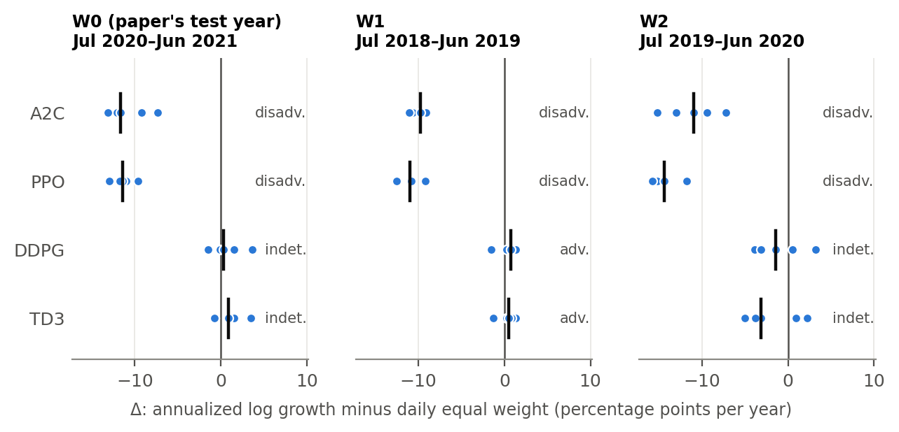

# Re-evaluation of official code — results (English draft, 2026-11-25)

> Working draft for thesis chapter 4 ("Results — re-evaluation of official code"), following `thesis/OUTLINE_KR.md`. Sources: `notes/prereg_reeval_v3.md` (chapters 4–5), `notes/finrl_t3_o5_result.md`, `notes/alphamix_t2_o5_static.md`, `notes/deeparies_o5_result.md`, `notes/deeparies_o4_result.md`, `notes/finrl_t3_o2_result.md`, `notes/finrl_t3_o6_result.md`, `notes/stat_power_result.md`, `notes/funnel_f7x_p2407_prereg.md` (sections 6–7.1), `notes/degenerate_policy_baseline_prereg.md`, `notes/static_holding_test_prereg.md` (§5–5.1), `notes/funnel_f7x_ensemble_turb_result.md`. Reproduction verdicts (O1) are in `thesis/en/reproduction_verdicts.md`. [check] marks numbers to re-verify before submission. Exploratory analyses are labelled in the text. No process details in the text.

---

## Z.1 Do the implementations charge the configured transaction cost?

Table Z0 summarizes the cost check (Section 3.6) for the official environments of DeepAries, AlphaMix+ and FinRL; MARS was not checked. Each runnable environment was driven with the three injected paths, after the expected outcome had been written down from reading the code; all predictions matched.

**Table Z0.** Transaction cost charged by the official environments.

| Implementation | Configured cost | Is the cost charged? | Agreement with the reference model |
|---|---|---|---|
| FinRL portfolio environment (T3) | 0.1% | No: rewards and returns are identical to those at zero cost | — |
| AlphaMix+ (T2) | 0.1% | No: the configured rate is read but never enters the return (static reading) | — |
| DeepAries (T1) | 0.01% | Yes | No: the charge is computed from the difference between the target two steps earlier and the current drifted target, and the first purchase is charged one step late |

For DeepAries, the deviation charges about 2% of the reference cost on the alternating path but between 1.0 and 1.37 times the reference cost on the paths of the trained policies, so the implementation neither systematically under- nor over-charges. At the paper's fee of 0.01%, the difference in annualized log growth between the original and the reference implementation was below 0.12 percentage points per year for every seed (median −0.006), because the total cost is small at that fee. We therefore do not attribute the DeepAries reproduction gap to the cost implementation.

Where an implementation failed either check, all evaluations in the unified protocol below use the reference cost model.

**Does the training signal respond to the cost? (pre-registered)** A cost that is charged in evaluation can still be absent from what a method learns from. We therefore checked, for 16 official code bases (the implementations with official code in our samples that had been examined for cost charging, together with the targets of Chapter §6), whether the training signal responds to the configured cost: for methods trained on a differentiable portfolio loss, the relative difference between parameter gradients at a cost of 0.01 and at zero; for methods trained by RL on an environment reward, the difference between the rewards received along a fixed path of trades. Thresholds, classes and the rule for a recurring finding were fixed in advance, after control implementations with and without a cost signal had been checked. No method was trained, and prices were synthetic. Thirteen implementations from eight code lineages (the FinRL stock-portfolio environment and its derivatives, FinRL stock-trading environments, PGPortfolio, TradeMaster, WaveCorr, EarnMore, DeepAries and MARS) were assessed under the pre-specified criteria; one further implementation could not be assessed, because its original loss became undefined on synthetic data, and two were reference cases known before the check. In nine of the thirteen (RAT, the ensemble strategy, WaveCorr, TradeMaster, the PGPortfolio fork used by Li (2024), DeepAries, MARS, Margin Trader and Markowitz Meets Bellman (Hu and Gu, 2024)), the training signal responded to the cost. In four it did not: in three (the FinRL portfolio environment, AlphaMix+ and EarnMore) the cost is charged neither in training nor in evaluation, and in one (MASA, a method in our main sample) the cost is deducted from the evaluated portfolio value but not from the training reward. The pre-specified criterion for a training–evaluation mismatch recurring across at least two lineages was therefore not met. Of the two reference cases, the original EIIE implementation of Jiang et al. (2017) passes the cost into its loss gradient. In the EIIE loss of FinRL's portfolio-optimization environment, the cost factor enters as a per-sample constant inside the logarithm, so its contribution to the gradient is zero by construction; our pre-specified numerical test was inconclusive for this case because of rounding in single precision at a very small gradient norm. The check establishes only whether the training signal responds to the cost, not whether training makes use of it or how it affects performance. In MARS, which responds to the cost, the reward adds a return expressed as a fraction and subtracts the cost in dollars on a capital of one million; on its training data the cost term exceeded the return term in 94–95% of steps under equal-weight targets and under the authors' released checkpoint, by a median factor of about 200 and 40 respectively (exploratory, without training). A separate experiment that restores the cost gradient in the FinRL EIIE loss is reported in Section §5.5.

## Z.2 FinRL under the unified protocol

Under the eligibility rule of Section 3.5, only the four FinRL algorithms were re-evaluated. Each was retrained with five seeds in three one-year test windows (W0: July 2020–June 2021, the paper's period; W1: July 2018–June 2019; W2: July 2019–June 2020), starting from cash and charged 0.1% under the reference cost model. The primary baseline is an equal-weight portfolio of the same 28 assets, rebalanced daily under the same cost. Windows and methods are classified by the rules of Section 3.5.

**Table Z1.** Δ (percentage points per year, seed median) against daily-rebalanced equal weight, 0.1% cost.

| Algorithm | W0 | W1 | W2 | Outcome |
|---|---|---|---|---|
| A2C | −11.63 (disadv.) | −9.79 (disadv.) | −10.98 (disadv.) | Lost |
| PPO | −11.43 (disadv.) | −11.02 (disadv.) | −14.38 (disadv.) | Lost |
| DDPG | +0.36 (indet.) | +0.74 (adv.) | −1.46 (indet.) | Indeterminate; small difference |
| TD3 | +0.88 (indet.) | +0.48 (adv.) | −3.15 (indet.) | Indeterminate |

**Figure 2.** FinRL under the unified protocol: Δ for each of five seeds (dots) and the seed median (vertical bar), by algorithm and test window, against daily-rebalanced equal weight at 0.1% cost. The label at the right of each row is the window classification (advantage or disadvantage when at least four of five seeds share the sign of Δ; indeterminate otherwise).

None of the four algorithms retained an advantage over equal weight; two lost it and two were indeterminate. The baseline itself grew at 30.99, 16.33 and 3.31% per year (log) in W0, W1 and W2. The classifications of A2C and PPO did not change under a higher cost (0.2%), under the original training code, or with monthly-rebalanced or buy-and-hold equal-weight baselines. The classifications of DDPG and TD3 (indeterminate) did not change under the higher cost or the original training code; no classification of these two was made against the alternative baselines.

## Z.3 Why the outcomes look as they do (exploratory)

The following diagnostics were carried out after the outcomes above were known and are reported as exploratory.

**Fixed portfolios (DDPG, TD3).** In every stored DDPG and TD3 evaluation run, every action lay on the boundary of the action space, and the target weights were identical on every day after the first. The policies therefore ended as fixed-weight portfolios that do not respond to their inputs. Which assets received the higher weight depended mainly on the seed and was largely unchanged across training windows and training conditions. Because the environment passes actions in [0, 1] through a softmax, any weight is confined to [1.34%, 9.15%] with 28 assets, so a fixed portfolio of this kind differs only moderately from equal weight. Untrained DDPG and TD3 policies initialized with the same seeds did not show this pattern (about a quarter of actions on the boundary, and target weights that changed every day), so the fixed portfolios arise during training.

**An untrained policy (PPO).** The distribution of PPO actions matched the distribution implied by the initial policy of the library (a zero-mean Gaussian with unit standard deviation, clipped to [0, 1]): for example, the mean action was 0.314 against a theoretical 0.316, and the statistics were the same in every window. Under deterministic prediction, PPO weights stayed within 0.001 of 1/28 on every day in all 15 runs. Untrained policies initialized with the same seeds gave the same summary statistics to within 1e-6 under both stochastic and deterministic prediction, so training moved the PPO policy negligibly from its initialization.

**Sampling at prediction time (A2C, PPO).** The official tutorial predicts with stochastic actions. This produces an average daily turnover of about 0.40 (A2C) and 0.46 (PPO), against about 0.01 for DDPG and TD3. At 0.1% cost, turnover of this size costs about 10–11 percentage points per year, which accounts for most of the A2C and PPO deficit. When the same trained models predict deterministically, the large deficit disappears, but no advantage appears: deterministic A2C is indeterminate and deterministic PPO is classified as lost, both with differences below 2 percentage points per year. The classification of A2C as lost therefore depends on the prediction setting; neither setting gives an advantage over equal weight.

**Relation to the reproduced claim.** In the paper's window, a deterministic PPO policy that is in effect a daily-rebalanced equal-weight portfolio earns 36.78% per year at zero cost, above the Dow Jones Industrial Average (34.07% in our computation over the same window) and within the tolerance band of the reported PPO value. The paper's comparison does not include an equal-weight baseline. The reproduced advantage over the index is therefore consistent with an allocation close to equal weight having outperformed the index in that period. This is the same model and window, not an independent test.

## Z.4 Effect sizes and detectable differences

To express the comparison as effect sizes rather than counts of seeds, we computed block-bootstrap confidence intervals (block length 20 days, conditional on the seeds) for the difference in Sharpe ratio (ΔSR) and in annualized log growth (ΔG) between each algorithm and the daily equal-weight baseline, averaged over three windows and five seeds. This analysis was specified after the classifications above were known (Section 3.7). Equivalence margins were fixed before the effect sizes were computed, from the smallest advantage over the index reported in the original paper (ΔSR ±0.09, ΔG ±2.36 percentage points per year).

**Table Z2.** FinRL against daily-rebalanced equal weight, 0.1% cost (95% intervals).

| Algorithm | ΔSR | Category | ΔG (pp/yr) | Category |
|---|---|---|---|---|
| A2C | −0.58 (−0.68, −0.48) | Inferior | −10.7 (−11.8, −9.6) | Inferior |
| PPO | −0.66 (−0.77, −0.54) | Inferior | −12.3 (−13.5, −11.1) | Inferior |
| DDPG | +0.02 (−0.04, +0.08) | Undetermined | +0.06 (−0.9, +1.0) | Equivalent |
| TD3 | +0.01 (−0.06, +0.08) | Undetermined | −0.18 (−1.4, +1.0) | Equivalent |

A2C and PPO are inferior to equal weight on both measures (Holm-adjusted p ≤ 0.001), in each of the three windows. For DDPG and TD3, the difference in log growth lies within the equivalence margin, and the Sharpe difference is undetermined for both; for DDPG this depends on block length (equivalent at 5 and 10 days, not at the pre-specified 20), whereas for TD3 it is undetermined at every block length. The minimum detectable effects at 80% power were 0.07–0.19 in Sharpe ratio and 1.1–1.7 percentage points per year in log growth. Daily returns of every FinRL run were highly correlated with those of the equal-weight baseline (0.982–0.998). DeepAries runs, which were not reproduced and were therefore not judged under the unified protocol, also correlated at 0.976–0.985 with an equal-weight portfolio of the assets they could hold, and their Sharpe difference was −0.04 (−0.13, +0.06). For the ensemble strategy, the Sharpe difference against the index was +0.53 (−0.74, +1.81), with a minimum detectable effect of 1.51, so the interval is too wide to be informative. AlphaMix+ was excluded from this analysis, as specified in advance, because its daily returns were not available to the analysis.

These intervals condition on the five seeds and on our three windows. The equivalence is specific to this setting (28 assets, 0.1% cost) and is the outcome one would expect from the parameterization described in Section Z.3; it is not a general statement that these algorithms equal 1/N.

## Z.5 A policy that holds what it buys on the first day (exploratory)

The same pattern appeared, in a stronger form, in the exploratory reproduction of Markowitz Meets Bellman (Table 3). Re-evaluating the released checkpoint reproduced the authors' stored account-value curve exactly. On the trading period, the checkpoint's deterministic actions were saturated at ±1 with a fixed sign for each asset, so after the initial purchases the portfolio was held unchanged. Saturation itself was not produced by training: untrained policies with the same architecture already had 70–87% of actions at |a| ≥ 0.99, but their signs changed from day to day; what training produced was the fixed sign per asset. The policy's output determined which assets were candidates for purchase. Because it requested the maximum purchase for three assets, which of them were bought, and in what quantity, was determined by the environment's tie-breaking order over asset columns and by the cash constraint; the account bought 96 shares of UNH and one of AAPL. Permuting the asset columns while keeping the policy's input and output in the original order yielded five different first-day holdings and Sharpe ratios from 1.24 to 1.96 for the released checkpoint; none of the 120 orderings exceeded the equal-weight portfolio of the same stocks (2.00). All five stored run outputs averaged into the reported curve were integer-share positions bought at the first day's close and held to the end of the test period (maximum absolute residual below 1e-11 USD); their date-wise mean reproduces the reported metrics exactly. Its Sharpe ratio (2.03) exceeds that of every constituent (1.61–1.81) because the averaged holdings are more diversified. Retraining the released code with five seeds gave an averaged-curve Sharpe ratio of 1.81, within our tolerance of the reported value, but no seed exceeded an equal-weight portfolio of the same five stocks (2.00). The released code does not include the knowledge-distillation component that the paper proposes, so these results say nothing about that component.

**Other share-based environments.** To see whether this pattern recurs, we applied a static-holding check to the two other reproduction targets whose environments hold share quantities (both exploratory, after the result above was known). For the ensemble strategy, whose stored outputs contain only account values, we fitted each 63-day trading cycle with fixed non-negative holdings plus cash from one of its first five days onward; no cycle in any of the five runs was fitted to within a relative residual of 1e-9 (median best residual 1.3–2.0e-3), indicating small trades within every cycle. This tolerance distinguishes only exactly fixed holdings; we did not judge whether the policies are economically close to buy-and-hold, and because the model is replaced every 63 days, holding over the whole test period is excluded by design. For Margin Trader, whose stored outputs include holdings, holdings were unchanged from the previous day on 90–92% of trading days but changed on 58–72 of about 751 days, 25 of which fall on multiples of 30 days, the period of the forced margin adjustment that we infer from the environment code; we did not separate these from trades requested by the policy. The pre-specified label for this pattern, 'partially static' (unchanged on at least half of the days), is weakly discriminating and is used only as a label. Neither target therefore showed the first-day buy-and-hold pattern observed for Markowitz Meets Bellman. We did not examine its cause or how general it is.

## Z.6 Sensitivity of the ensemble strategy to its turbulence threshold (exploratory)

The ensemble strategy moves to cash when a market turbulence index exceeds a threshold. In the released code the threshold is 140, described as based on the in-sample data, and is overwritten to 100 and then 90 in later trading periods. We compared, with five runs per condition, the released code (P) against three counterfactuals: the initial value of 140 throughout (C, pre-specified as the primary contrast), the quantile-based rule that the authors later added to the same repository (T), and no turbulence rule (O). The metric is the ensemble Sharpe ratio on the test period used for our reproduction verdict; contrasts are mean differences with Welch 95% intervals.

**Table Z3.** Ensemble Sharpe ratio under alternative turbulence thresholds (five runs each).

| Condition | Mean Sharpe | Difference from P | 95% interval |
|---|---|---|---|
| P: released code (140 → 100 → 90) | 1.01 | — | — |
| C: 140 throughout (primary) | 0.79 | −0.22 | (−0.44, −0.003) |
| T: authors' later quantile rule | 0.79 | −0.22 | (−0.57, +0.14) |
| O: no turbulence rule | 0.27 | −0.74 | (−0.95, −0.52) |

Using 140 throughout lowered the Sharpe ratio by 0.22. The interval barely excludes zero, and the difference is below the minimum detectable effect of the design (about 0.24), so we treat it as weak evidence of sensitivity to the threshold choice. Under the constant threshold, the number of zero-return days fell from 375 to 138 of 1,097, and annualized volatility (+3.6 percentage points) and maximum drawdown were larger in every run, whereas cumulative return did not differ distinguishably. Because the threshold also enters the validation environment used for model selection, these differences cannot be attributed to a single mechanism. The authors' later rule did not yield a distinguishable difference, although differences below roughly 0.5 cannot be excluded given its higher run-to-run variance (SD 0.29). In this code, disabling the rule (an ablation that also changes model selection) lowered the Sharpe ratio by 0.74; the test period includes the market fall of March 2020. None of the variants approached the reported Sharpe ratio of 1.30; this experiment does not account for the gap between the reported value and ours. The authors' later rule was published after the end of the test period.

These comparisons do not show whether the thresholds used in the paper were chosen with knowledge of the test period. The code computes the turbulence index from price levels, whereas the paper defines it on returns; we kept the code's definition.

## Z.7 Equal weight for the other judged methods (exploratory)

The unified protocol was applied only to FinRL, the one pre-selected method that was at least partially reproduced. After its result was known, we compared the stored test outputs of three further judged methods whose papers do not include equal weight with a daily-rebalanced equal-weight portfolio of the same assets over the same dates, charged at the rate the method's environment implements or is configured with, starting from cash. The rule and its wording were fixed before the comparison. The comparison is exploratory and does not enter the verdicts.

- **DeepAries.** Four of ten seeds exceeded equal weight in compound annual growth; the seed selected by the paper's rule was 0.13 percentage points below it. The outcome was mixed.
- **MARS.** With the code as of publication, two of ten seeds exceeded equal weight in Sharpe ratio and three of ten in cumulative return; most did not exceed it. With the authors' later revision, reported alongside, seven and eight of ten did.
- **Ensemble strategy.** All five runs exceeded equal weight in Sharpe ratio (mean 1.01 against 0.44). The difference was concentrated in the first months of 2020: before 2020, equal weight had a Sharpe ratio of 1.02 against a mean of about 1.07 for the runs, and between 19 February and 12 May 2020 equal weight lost 17.9% while each run lost less than 0.5%, consistent with the strategy's move to cash when its turbulence index exceeded the threshold. With the turbulence rule disabled (Section Z.6), its Sharpe ratio was below that of equal weight. Conversely, equal weight with the same turbulence rule and thresholds and no RL policy reached a Sharpe ratio of 1.19 over the same period, at least as high as each of the five runs (1.18 at most); the thresholds were set by the original authors from the same period, so this comparison is not out of sample.

These comparisons involve five or ten runs and a single test period each. For the ensemble strategy, paired circular block bootstrap intervals (20-day blocks) for the difference in Sharpe ratio between each run and equal weight with the turbulence rule all contained zero (point estimates −0.01 to −0.34), so over this period the learned policy was not distinguishable from the rule alone; the period and the thresholds were not held out. In an exploratory extension to the period after the paper's data (29 of the 30 original constituents, because one has since been delisted; trading from 6 October 2020 to 10 October 2025; five runs), no run exceeded the Sharpe ratio of equal weight under the same cost (mean −0.02 against 0.85), nor that of equal weight with the same turbulence rule (0.36). The code's turbulence index is computed from price levels and exceeded the hard-coded thresholds on about half of the trading days of this period, so the result mainly reflects how the rule behaves outside the period it was calibrated on rather than the learned policy alone. The extension required changing the number of assets in the code and uses a single data source; it is exploratory and does not estimate a decline after publication.

## Z.8 Summary of the re-evaluation

- Two of three implementations judged for costs did not charge the configured transaction cost, and the third charged it with a formula different from the one stated in the paper; at the paper's fee the difference was negligible. Across thirteen implementations assessed for whether their training signal responds to the cost, four did not respond; in one of these the cost was charged in evaluation only.
- Under a common protocol with costs, a cash start and an equal-weight baseline, none of the four FinRL algorithms retained an advantage. In exploratory diagnostics, the two that lost it did so mainly through turnover generated by stochastic prediction, and the two that were indeterminate had become fixed-weight portfolios whose returns were highly correlated with those of equal weight, with growth differences within the equivalence margin on average.
- In exploratory diagnostics, policies obtained by running the released code were degenerate in identifiable ways (fixed weights for DDPG and TD3, behaviour indistinguishable from initialization for PPO), and for Markowitz Meets Bellman the authors' stored outputs behind the reported curve were first-day buy-and-hold positions whose composition was set by the environment's order filling. This buy-and-hold pattern was not found in two other targets with share-based environments.
- There was weak evidence that the ensemble strategy's Sharpe ratio is sensitive to its hard-coded turbulence threshold; in this code, disabling the turbulence rule lowered it by 0.74. No variant came close to the reported value.
- In an exploratory comparison with equal weight, DeepAries was mixed, MARS as published mostly did not exceed it, and the ensemble strategy exceeded it in all runs, with the difference concentrated in a period when its turbulence rule moved it to cash.
